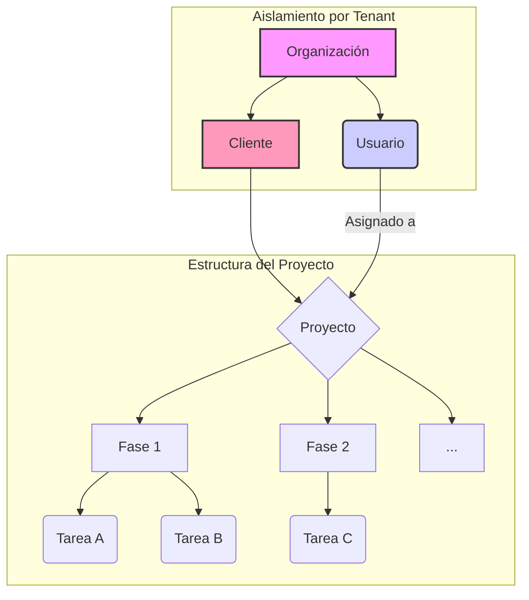

# Plan de Desarrollo - ArcManager

Este documento resume la estrategia y los pasos técnicos para construir ArcManager.

## 1. Objetivo General

Crear un **"Organizador Visual de Proyectos"** para arquitectos, con una capa de gestión multi-tenant que permita a diferentes organizaciones utilizar la herramienta de forma aislada y bajo un modelo de suscripción.

## 2. Módulos y Progreso

### **Módulo 1: Gestión Administrativa**
- **Estado:** ✅ **Completado**
- **Descripción:** Panel central para administrar organizaciones y suscripciones.

### **Módulo 2: Nueva Arquitectura de Proyectos por Fases**
- **Estado:** ✅ **Completado**
- **Descripción:** Se ha refactorizado la base de datos para adoptar una estructura más robusta y escalable, centrada en el concepto de Fases.

### **Módulo 3: Interfaz Visual e Interactiva (Kanban)**
- **Estado:** ✅ **Completado**
- **Descripción:** Construcción de la interfaz visual del tablero Kanban con funcionalidad de arrastrar y soltar (Drag and Drop).

### **Módulo 4: Mejoras de Experiencia de Usuario (UX)**
- **Estado:** ✅ **Completado**
- **Descripción:** Implementación de modales, vistas personalizadas ("Mis Tareas") y mejoras en los flujos de interacción.

### **Módulo 5: Pulido y Corrección de Tareas**
- **Estado:** ✅ **Completado**
- **Descripción:** Corrección de errores en la asignación de usuarios y la gestión de formularios.

## 3. Arquitectura y Flujo de Datos

## 4. Próximos Pasos

A continuación se detallan las fases restantes para completar el MVP (Producto Mínimo Viable).

### **Fase 6: Módulo de Gestión de Clientes**
- **Estado:** ✅ **Completado**
- **Descripción:** Añade una entidad `Cliente` para centralizar su información y vincularla directamente a los proyectos.
- **Componentes Realizados:**
    - **[✓]** Modelo `Client` y relación con `Project`.
    - **[✓]** CRUD de Clientes (Vistas, URLs, Formularios, Plantillas).
    - **[✓]** Integración en el formulario de Proyectos.
    - **[✓]** Seguridad Multi-Tenant implementada con Mixins.
    - **[✓]** Enlace añadido en la barra de navegación.
    - **[✓]** Pulido de UI con `crispy-forms`.
    - **[✓]** Integración visual en la ficha del proyecto.
    - **[✓]** Vista de detalle del cliente con sus proyectos.

### **Fase 7: Pulido Técnico de Módulos Core**
- **Estado:** ✅ **Completado**
- **Descripción:** Refactorizar y mejorar los modelos y la lógica de negocio de los módulos principales para asegurar la escalabilidad y la integridad de los datos.
- **Tareas de Mejora (Proyecto/Tareas):**
    - **[✓]** **Añadir relación con Organización:** Vincular el modelo `Project` directamente con `Organization` para un correcto aislamiento de datos (multi-tenant).
    - **[✓]** **Añadir Estado al Proyecto:** Implementar un campo `status` en el modelo `Project` (p. ej., Activo, Archivado, Completado).
    - **[✓]** **Automatizar Estado de Fases:** Usar signals de Django para que el estado de una `Phase` cambie a "En Progreso" cuando una de sus tareas se inicie.
    - **[✓]** **(Opcional) Fechas de Duración:** Evaluar y añadir campos `start_date` y `end_date` a `Project` y `Phase`.
- **Tareas de Mejora (Clientes):**
    - **[✓]** **Revisión final del flujo:** Confirmar que la integración del cliente en proyectos es robusta y no presenta fisuras.

### **Fase 8: Dashboard Principal y Central de Actividad**
- **Estado:** ✅ **Completado**
- **Descripción:** Crear un panel de control (`dashboard`) que sirva como punto de entrada a la aplicación, mostrando información relevante de un vistazo.
- **Componentes Clave:**
    - **[✓]** **Widget "Mis Tareas":** Un resumen de las tareas asignadas al usuario actual.
    - **[✓]** **Widget "Proyectos Activos":** Un listado de los proyectos con actividad reciente.
    - **[✓]** **Widget "Resumen de Clientes":** Número total de clientes y acceso rápido a los más recientes.
    - **[ ]** **Feed de Actividad Reciente:** Un historial de las últimas acciones en la organización (ej: "Usuario X creó la tarea Y").

### **Fase 9: Gestión Avanzada de Archivos y Notas**
- **Estado:** ⚪ **Pendiente**
- **Descripción:** Completar y mejorar la funcionalidad de gestión de archivos y añadir notas colaborativas, una característica que quedó pendiente.
- **Componentes:**
    - **[ ]** **Subida de Archivos por Fase:** Permitir adjuntar múltiples archivos directamente a cada fase del proyecto, no solo al proyecto en general.
    - **[ ]** **Notas por Fase:** Añadir un campo de "notas" o "comentarios" a nivel de fase para facilitar la comunicación del equipo sobre etapas específicas.

### **Fase 10: Refinamiento Final y Pre-Lanzamiento**
- **Estado:** ⚪ **Pendiente**
- **Descripción:** Revisión general de la aplicación, corrección de errores menores, optimización del rendimiento y preparación para un despliegue.
- **Componentes:**
    - **[ ]** Pruebas de usabilidad en todo el flujo.
    - **[ ]** Optimización de consultas a la base de datos.
    - **[ ]** Revisión de la seguridad.

## 5. Notas de Desarrollo

### Flujo de Trabajo con Docker y Base de Datos

Para evitar conflictos y tener un control claro sobre el estado de la base de datos, se ha optimizado el flujo de trabajo:

1.  **Arranque del Entorno:**
    -   `docker-compose up -d`: Inicia todos los servicios.
    -   `docker-compose exec web python manage.py setup_database --force`: **(Solo la primera vez o si la BD está vacía)**. Configura la base de datos, crea el superusuario y los planes iniciales.

2.  **Al modificar `models.py`:**
    -   `docker-compose exec web python manage.py makemigrations`: Crea los archivos de migración.
    -   `docker-compose exec web python manage.py migrate`: Aplica los cambios a la base de datos.

3.  **Reiniciar el servidor web:**
    -   `docker-compose restart web`: Aplica cambios que no son de base de datos.

Este enfoque manual y explícito previene inconsistencias y te da control total sobre el esquema de la base de datos.

## 6. Deuda Técnica y Optimizaciones Identificadas

Esta sección documenta mejoras técnicas específicas que se han identificado durante la revisión del código. Abordarlas mejorará el rendimiento, la mantenibilidad y la escalabilidad de la aplicación a largo plazo.

-   **[✓]** **Optimizar Consultas N+1 en Vistas de Lista:**
    -   **Descripción:** Varias vistas de lista (`ProjectListView`, `TaskListView`, `MyTaskListView`, `ClientDetailView`) realizan consultas a la base de datos dentro de un bucle al renderizar las plantillas. Esto ocurre cuando se accede a datos de modelos relacionados (ej. `project.client.name` o `task.phase.project.name`).
    -   **Solución:** Utilizar `select_related` y `prefetch_related` en los `get_queryset` de estas vistas para cargar todos los datos necesarios en una sola consulta, reduciendo drásticamente la carga en la base de datos.
    -   **Por qué es importante:** Evita que la aplicación se vuelva lenta a medida que aumenta la cantidad de proyectos, tareas y clientes. Es una de las optimizaciones de rendimiento más críticas en Django.

-   **[✓]** **Usar `bulk_create` para la Creación de Fases por Defecto:**
    -   **Descripción:** En `ProjectCreateView`, cuando se crea un proyecto sin una plantilla, las fases por defecto se crean una por una en un bucle, resultando en múltiples inserciones en la base de datos.
    -   **Solución:** Crear una lista de objetos `Phase` y luego insertarlos todos a la vez usando `Phase.objects.bulk_create()`.
    -   **Por qué es importante:** Reduce múltiples escrituras a la base de datos a una sola operación, haciendo la creación de proyectos más rápida y atómica.

-   **[✓]** **Eliminar o Refactorizar Código Obsoleto (`advance_project_phase`):**
    -   **Descripción:** La función `advance_project_phase` en `projects/views.py` contiene una lógica que no coincide con la estructura actual de los modelos (`Phase` es un modelo, no una lista de opciones). Actualmente, este código está roto y no se utiliza.
    -   **Solución:** Eliminar la función y su URL correspondiente para limpiar el código base y evitar confusiones. Si la funcionalidad es necesaria, debe ser reescrita desde cero.
    -   **Por qué es importante:** Mejora la mantenibilidad del código al eliminar partes que no funcionan y que podrían causar errores o ser malinterpretadas por otros desarrolladores en el futuro.
