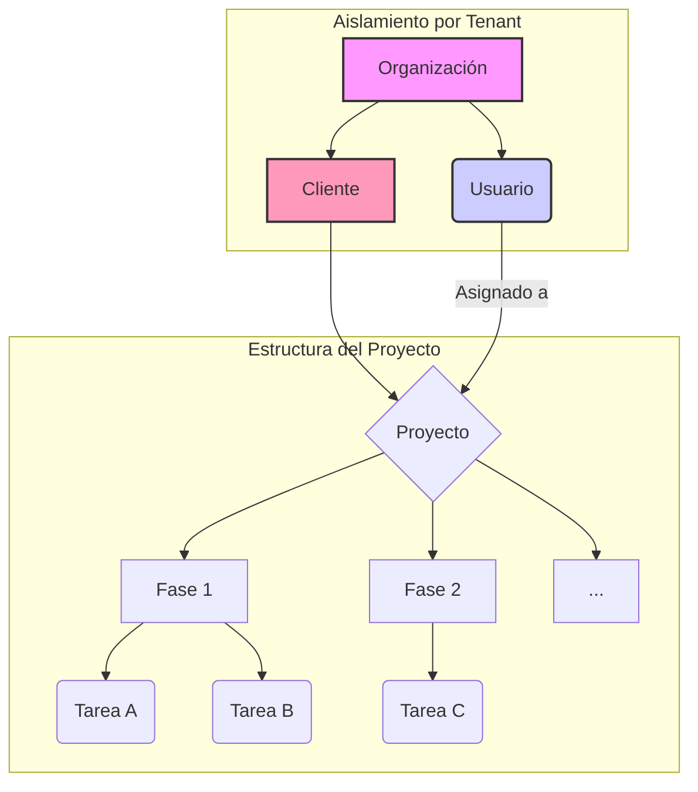

# Plan de Desarrollo - ArcManager

Este documento resume la estrategia y los pasos técnicos para construir ArcManager.

## 1. Objetivo General

Crear un **"Organizador Visual de Proyectos"** para arquitectos, con una capa de gestión multi-tenant que permita a diferentes organizaciones utilizar la herramienta de forma aislada y bajo un modelo de suscripción.

## 2. Visión Estratégica y Flujo de Usuario (UX)

Para asegurar la adopción y el éxito de ArcManager entre los arquitectos, la aplicación debe ser intuitiva y reflejar los flujos de trabajo naturales del sector de la construcción. Esta sección define la filosofía de diseño y la estructura funcional que guiará el desarrollo.

### Principios Clave
- **Simplicidad para el MVP:** Enfocarse en las funcionalidades esenciales que resuelven problemas reales, evitando la complejidad innecesaria.
- **Consistencia:** La interfaz y la lógica de negocio deben ser predecibles y fáciles de entender.
- **Flujo de Trabajo Natural:** La estructura de la aplicación debe emular cómo los arquitectos gestionan sus proyectos en el mundo real.

### Estructura Centrada en Fases de Proyecto

El corazón de la aplicación será la organización de los proyectos en **Fases**, que son distintas a los estados del tablero Kanban. Un proyecto ya no será una entidad monolítica, sino un contenedor de fases secuenciales.

- **Fases de Proyecto:** Representan las etapas macro de un proyecto de arquitectura (p. ej., "Estudios Preliminares", "Anteproyecto", "Proyecto de Ejecución", "Dirección de Obra").
    -   **Modelo de Datos:** Existirá un modelo `Phase` con nombre, descripción, fechas y una relación directa con `Project`.
    -   **Creación de Proyectos:** Se eliminará el concepto de "Plantillas de Proyecto" para simplificar. Al crear un proyecto, se podrán generar un conjunto de fases por defecto, que el usuario podrá personalizar, eliminando la rigidez de las plantillas.

### Gestión de Archivos por Fases

El módulo `files` se integrará directamente con las Fases de Proyecto para crear una estructura de carpetas virtual e intuitiva.

-   **Asociación:** Cada archivo subido se asociará a un `Proyecto` y a una `Fase` específica.
-   **Visualización:** La vista de detalle del proyecto se organizará en torno a estas fases, permitiendo a los usuarios navegar fácilmente por la documentación de cada etapa.

### Gestión de Tareas (Kanban)

El tablero Kanban se mantendrá como la herramienta para la gestión de tareas del día a día.

-   **Asociación:** Cada `Task` podrá vincularse a una `FaseProyecto` para contextualizar el trabajo.
-   **Estados del Kanban:** Para reflejar mejor el lenguaje del sector, el estado **"Bloqueado"** se renombrará a **"En Pausa"**.

## 3. Módulos y Progreso

### **Módulo 1: Gestión Administrativa**
- **Estado:** ✅ **Completado**
- **Descripción:** Panel central para administrar organizaciones y suscripciones.

### **Módulo 2: Nueva Arquitectura de Proyectos por Fases**
- **Estado:** ✅ **Completado**
- **Descripción:** Se ha refactorizado la base de datos para adoptar una estructura más robusta y escalable, centrada en el concepto de Fases.

### **Módulo 3: Interfaz Visual e Interactiva (Kanban)**
- **Estado:** ✅ **Completado**
- **Descripción:** Construcción de la interfaz visual del tablero Kanban con funcionalidad de arrastrar y soltar (Drag and Drop).

### **Módulo 4: Mejoras de Experiencia de Usuario (UX)**
- **Estado:** ✅ **Completado**
- **Descripción:** Implementación de modales, vistas personalizadas ("Mis Tareas") y mejoras en los flujos de interacción.

### **Módulo 5: Pulido y Corrección de Tareas**
- **Estado:** ✅ **Completado**
- **Descripción:** Corrección de errores en la asignación de usuarios y la gestión de formularios.

## 4. Arquitectura y Flujo de Datos

## 5. Próximos Pasos

A continuación se detallan las fases restantes para completar el MVP (Producto Mínimo Viable).

### **Fase 6: Módulo de Gestión de Clientes**
- **Estado:** ✅ **Completado**
- **Descripción:** Añade una entidad `Cliente` para centralizar su información y vincularla directamente a los proyectos.
- **Componentes Realizados:**
    - **[✓]** Modelo `Client` y relación con `Project`.
    - **[✓]** CRUD de Clientes (Vistas, URLs, Formularios, Plantillas).
    - **[✓]** Integración en el formulario de Proyectos.
    - **[✓]** Seguridad Multi-Tenant implementada con Mixins.
    - **[✓]** Enlace añadido en la barra de navegación.
    - **[✓]** Pulido de UI con `crispy-forms`.
    - **[✓]** Integración visual en la ficha del proyecto.
    - **[✓]** Vista de detalle del cliente con sus proyectos.

### **Fase 7: Pulido Técnico de Módulos Core**
- **Estado:** ✅ **Completado**
- **Descripción:** Refactorizar y mejorar los modelos y la lógica de negocio de los módulos principales para asegurar la escalabilidad y la integridad de los datos.
- **Tareas de Mejora (Proyecto/Tareas):**
    - **[✓]** **Añadir relación con Organización:** Vincular el modelo `Project` directamente con `Organization` para un correcto aislamiento de datos (multi-tenant).
    - **[✓]** **Añadir Estado al Proyecto:** Implementar un campo `status` en el modelo `Project` (p. ej., Activo, Archivado, Completado).
    - **[✓]** **Automatizar Estado de Fases:** Usar signals de Django para que el estado de una `Phase` cambie a "En Progreso" cuando una de sus tareas se inicie.
    - **[✓]** **(Opcional) Fechas de Duración:** Evaluar y añadir campos `start_date` y `end_date` a `Project` y `Phase`.
- **Tareas de Mejora (Clientes):**
    - **[✓]** **Revisión final del flujo:** Confirmar que la integración del cliente en proyectos es robusta y no presenta fisuras.

### **Fase 8: Dashboard Principal y Central de Actividad**
- **Estado:** ✅ **Completado**
- **Descripción:** Crear un panel de control (`dashboard`) que sirva como punto de entrada a la aplicación, mostrando información relevante de un vistazo.
- **Componentes Clave:**
    - **[✓]** **Widget "Mis Tareas":** Un resumen de las tareas asignadas al usuario actual.
    - **[✓]** **Widget "Proyectos Activos":** Un listado de los proyectos con actividad reciente.
    - **[✓]** **Widget "Resumen de Clientes":** Número total de clientes y acceso rápido a los más recientes.

### **Fase 9: Módulo de Gestión de Archivos y Notas**
- **Estado:** ✅ **Completado**
- **Descripción:** Se ha implementado un sistema para gestionar archivos y notas a nivel de fase, mejorando la colaboración y la organización de los proyectos.
- **Funcionamiento:**
    - Desde el tablero Kanban de un proyecto, cada fase tiene un menú de acciones que permite acceder a una nueva vista de **"Detalle de Fase"**.
    - En esta vista, los usuarios pueden:
        - **Subir uno o más archivos** directamente a la fase.
        - **Visualizar una lista de los archivos** de la fase, con enlaces para verlos y opciones para eliminarlos.
        - **Añadir y editar notas de texto** en un campo específico para la fase.
    - La lógica de negocio está encapsulada en una nueva aplicación `files`, y el sistema de archivos está preparado para una futura integración con almacenamiento en la nube (S3).
- **Componentes Realizados:**
    - **[✓]** Nueva app `files` para la gestión de archivos.
    - **[✓]** Campo `notes` añadido al modelo `Phase`.
    - **[✓]** Modelo `ProjectFile` para asociar archivos a las fases.
    - **[✓]** Vistas para la subida y eliminación de archivos.
    - **[✓]** Nueva página de "Detalle de Fase" para centralizar la gestión.
    - **[✓]** Integración en la interfaz del tablero Kanban.

### **Fase 10: Refinamiento Final y Pre-Lanzamiento**
- **Estado:** ⚪ **Pendiente**
- **Descripción:** Revisión general de la aplicación, corrección de errores menores, optimización del rendimiento y preparación para un despliegue.
- **Componentes:**
    - **[ ]** Pruebas de usabilidad en todo el flujo.
    - **[ ]** Optimización de consultas a la base de datos.
    - **[ ]** Revisión de la seguridad.

## 6. Notas de Desarrollo

### Flujo de Trabajo con Docker y Base de Datos

Para evitar conflictos y tener un control claro sobre el estado de la base de datos, se ha optimizado el flujo de trabajo:

1.  **Arranque del Entorno:**
    -   `docker-compose up -d`: Inicia todos los servicios.
    -   `docker-compose exec web python manage.py setup_database --force`: **(Solo la primera vez o si la BD está vacía)**. Configura la base de datos, crea el superusuario y los planes iniciales.

2.  **Al modificar `models.py`:**
    -   `docker-compose exec web python manage.py makemigrations`: Crea los archivos de migración.
    -   `docker-compose exec web python manage.py migrate`: Aplica los cambios a la base de datos.

3.  **Reiniciar el servidor web:**
    -   `docker-compose restart web`: Aplica cambios que no son de base de datos.

Este enfoque manual y explícito previene inconsistencias y te da control total sobre el esquema de la base de datos.

## 7. Deuda Técnica y Optimizaciones Identificadas

Esta sección documenta mejoras técnicas específicas que se han identificado durante la revisión del código. Abordarlas mejorará el rendimiento, la mantenibilidad y la escalabilidad de la aplicación a largo plazo.

-   **[✓]** **Optimizar Consultas N+1 en Vistas de Lista:**
    -   **Descripción:** Varias vistas de lista (`ProjectListView`, `TaskListView`, `MyTaskListView`, `ClientDetailView`) realizan consultas a la base de datos dentro de un bucle al renderizar las plantillas. Esto ocurre cuando se accede a datos de modelos relacionados (ej. `project.client.name` o `task.phase.project.name`).
    -   **Solución:** Utilizar `select_related` y `prefetch_related` en los `get_queryset` de estas vistas para cargar todos los datos necesarios en una sola consulta, reduciendo drásticamente la carga en la base de datos.
    -   **Por qué es importante:** Evita que la aplicación se vuelva lenta a medida que aumenta la cantidad de proyectos, tareas y clientes. Es una de las optimizaciones de rendimiento más críticas en Django.

-   **[✓]** **Usar `bulk_create` para la Creación de Fases por Defecto:**
    -   **Descripción:** En `ProjectCreateView`, cuando se crea un proyecto sin una plantilla, las fases por defecto se crean una por una en un bucle, resultando en múltiples inserciones en la base de datos.
    -   **Solución:** Crear una lista de objetos `Phase` y luego insertarlos todos a la vez usando `Phase.objects.bulk_create()`.
    -   **Por qué es importante:** Reduce múltiples escrituras a la base de datos a una sola operación, haciendo la creación de proyectos más rápida y atómica.

-   **[✓]** **Eliminar o Refactorizar Código Obsoleto (`advance_project_phase`):**
    -   **Descripción:** La función `advance_project_phase` en `projects/views.py` contiene una lógica que no coincide con la estructura actual de los modelos (`Phase` es un modelo, no una lista de opciones). Actualmente, este código está roto y no se utiliza.
    -   **Solución:** Eliminar la función y su URL correspondiente para limpiar el código base y evitar confusiones. Si la funcionalidad es necesaria, debe ser reescrita desde cero.
    -   **Por qué es importante:** Mejora la mantenibilidad del código al eliminar partes que no funcionan y que podrían causar errores o ser malinterpretadas por otros desarrolladores en el futuro.

## Plan de Trabajo y Estado Actual

Esta sección funciona como una hoja de ruta (roadmap) y un registro de cambios (changelog). Aquí se documenta el progreso y las tareas pendientes.

### ✅ **Hito 1: Fundación y Módulos Base (Completado)**
- **[✓]** **Gestión Administrativa:** Panel para altas de organizaciones y suscripciones.
- **[✓]** **Módulo de Clientes:** CRUD completo para la gestión de clientes.
- **[✓]** **Dashboard Principal:** Panel inicial con widgets de resumen (mis tareas, proyectos activos).

### ✅ **Hito 2: Refactorización a una Arquitectura por Fases (Completado)**
- **[✓]** **Modelos de Datos:** Se eliminó la complejidad de las "Plantillas de Proyecto" y se consolidó la estructura `Project -> Phase -> Task`.
- **[✓]** **Flujo de Creación:** Al crear un proyecto, se generan automáticamente fases estándar de arquitectura (ej. "Estudios Preliminares", "Anteproyecto", etc.), simplificando el proceso.
- **[✓]** **Limpieza de Código:** Se refactorizaron vistas, formularios, URLs y el panel de administrador para eliminar el código obsoleto.
- **[✓]** **Base de Datos:** Se crearon y aplicaron las migraciones para reflejar la nueva estructura.

### ✅ **Hito 3: Integración de Archivos y UI (Completado)**
- **[✓]** **Módulo de Archivos (`files`):**
    -   **[✓]** **Conectar Archivos a Fases:** Se ha implementado la lógica para que los archivos se puedan subir y asociar directamente a una fase específica del proyecto.
    -   **[✓]** **Vista de Gestión de Archivos:** Se ha creado una interfaz (`phase_detail.html`) donde los usuarios pueden ver, descargar y eliminar los archivos de una fase de forma asíncrona con HTMX.
- **[✓]** **Mejora de la Interfaz de Proyecto (`project_detail`):**
    -   **[✓]** **Visualización por Fases:** Se ha rediseñado la página de detalle del proyecto. Ahora es una vista organizada por fases en formato de acordeón, mostrando un resumen de tareas y archivos.
    -   **[✓]** **Acceso al Kanban:** Se ha añadido un botón claro en la vista de detalle del proyecto que lleva a un tablero Kanban independiente (`kanban_board.html`).
- **[✓]** **Ajustes Finales en Kanban:**
    -   **[✓]** **Confirmar Estado "En Pausa":** Se ha verificado en el modelo `Task` que el estado "Bloqueado" ha sido reemplazado por "En Pausa".

### ⚪ **Hito 4: Refinamiento y Pre-Lanzamiento (Pendiente)**
- **[ ]** **Pruebas de Usabilidad (E2E):** Realizar un recorrido completo por la aplicación desde la perspectiva de un arquitecto para identificar puntos de fricción.
- **[ ]** **Optimización de Rendimiento:** Revisar consultas a la base de datos y tiempos de carga.
- **[ ]** **Revisión de Seguridad:** Asegurar que los datos de las organizaciones estén correctamente aislados.