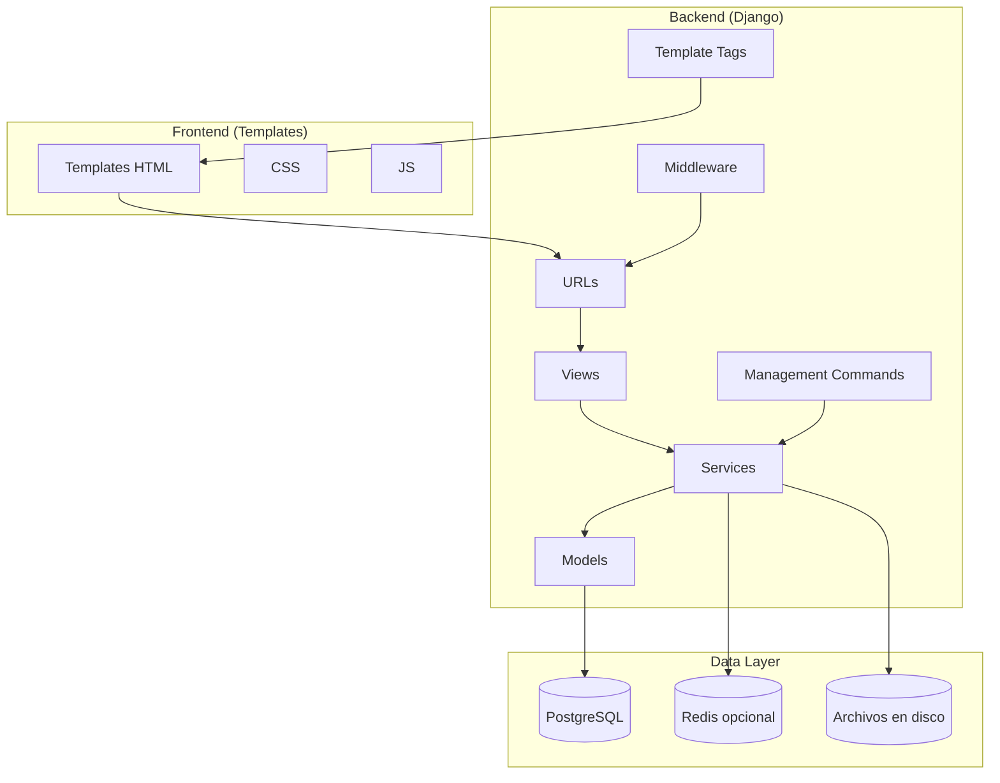

# ArcManager — Documentación Maestra

Índice

- 1. Visión general
  - 1.1 ¿Qué es ArcManager?
  - 1.2 Casos de uso
  - 1.3 Arquitectura lógica
- 2. Guía de inicio (Manual de Usuario)
  - 2.1 Requisitos
  - 2.2 Instalación rápida (Docker)
  - 2.3 Acceso y primeros pasos
  - 2.4 Flujos principales de uso
- 3. Documentación técnica
  - 3.1 Estructura del proyecto
  - 3.2 Configuración y variables de entorno
  - 3.3 Arquitectura backend y middleware
  - 3.4 Módulos y componentes
  - 3.5 Endpoints principales por módulo
  - 3.6 Datos y modelos (visión general)
  - 3.7 Arquitectura de Base de Datos (ER)
  - 3.8 Documentación técnica por módulo
- 4. Guía para desarrolladores
  - 4.1 Clonar, instalar, ejecutar
  - 4.2 Comandos de gestión útiles
  - 4.3 Desarrollo local y pruebas
  - 4.4 Despliegue
- 5. Mejores prácticas
- 6. Troubleshooting


## 1. Visión general

### 1.1 ¿Qué es ArcManager?

ArcManager es un sistema de gestión organizacional basado en Django que permite a organizaciones administrar clientes, proyectos, fases y tareas, con soporte para archivos, usuarios y planes de suscripción.

Tecnologías clave: Python 3.11, Django 5.2, PostgreSQL 15, Docker, Redis (opcional).

### 1.2 Casos de uso

- Gestión de proyectos y fases con tablero Kanban.
- Gestión de tareas (creación, edición, movimiento entre fases, estados).
- Gestión de clientes y organización.
- Gestión de usuarios de la organización.
- Panel de suscripción y solicitud de upgrade de plan.
- Carga y eliminación de archivos asociados a fases de proyecto.

### 1.3 Arquitectura lógica




## 2. Guía de inicio (Manual de Usuario)

### 2.1 Requisitos

- Docker y Docker Compose instalados.
- Puertos libres: 8000 (web), 5432 (db), 6379 (redis opcional).

### 2.2 Instalación rápida (Docker)

```bash
git clone <url-del-repositorio>
cd arc_manager
cp env.example .env
docker-compose up -d --build
# Acceso: http://localhost:8000
```

Notas:
- Los comandos manage.py deben ejecutarse dentro del contenedor web.
- Base de datos por defecto: PostgreSQL 15 en contenedor `db`.

### 2.3 Acceso y primeros pasos

1) Crea un superusuario (para admin de Django):
```bash
docker-compose exec web python manage.py createsuperuser
```

2) Inicia sesión de usuario normal en `http://localhost:8000/accounts/login/`.

3) Navegación principal:
- Dashboard: `http://localhost:8000/main/`
- Proyectos: `http://localhost:8000/projects/`
- Usuarios: `http://localhost:8000/users/`
- Clientes de la organización: `http://localhost:8000/organizations/clients/`
- Suscripción: `http://localhost:8000/plans/dashboard/`

### 2.4 Flujos principales de uso

- Proyectos y tablero Kanban
  1. Crear proyecto en `Projects > New`.
  2. Acceder al detalle del proyecto para ver fases y tareas.
  3. En el Kanban, mover tareas entre estados, actualizar estado/propiedades.

- Gestión de tareas
  - Crear tarea desde el proyecto (elige fase; si no existe, se crea "Backlog").
  - Editar tarea desde el modal de edición; soporta actualización parcial y respuesta para HTMX.

- Archivos en fases
  - Subir archivos desde la pestaña de archivos en el detalle del proyecto.
  - Eliminar archivos desde la misma lista.

- Suscripción y actualización de plan
  - Revisar estado en `Plans > Dashboard`.
  - Solicitar upgrade en `Plans > Solicitar actualización` (solo org_admin).

- Usuarios y clientes
  - Gestionar usuarios desde `Users` (crear, editar, ver detalle, eliminar vía AJAX).
  - Gestionar clientes desde `Organizations > Clients`.


## 3. Documentación técnica

### 3.1 Estructura del proyecto

```
arc_manager/
├─ arc_manager/
│  ├─ core/                  # settings, urls, wsgi, asgi
│  ├─ apps/
│  │  ├─ accounts/           # login/logout, reset password, middlewares
│  │  ├─ main/               # dashboard principal
│  │  ├─ orgs/               # organización y clientes
│  │  ├─ users/              # gestión de usuarios
│  │  ├─ plans/              # suscripciones y upgrades
│  │  ├─ projects/           # proyectos, fases, tareas
│  │  └─ files/              # carga/eliminación de archivos
│  ├─ templates/             # templates globales
│  └─ static/                # css/js/imágenes
├─ docker-compose.yml
├─ Dockerfile
├─ requirements.txt
└─ README.md
```

### 3.2 Configuración y variables de entorno

Ver `docs/tecnico/configuracion/CONFIGURACION.md`.

### 3.3 Arquitectura backend y middleware

Ver `docs/tecnico/INTRO_ARQUITECTURA.md`.

### 3.4 Módulos y componentes

Ver `docs/tecnico/README.md`.

### 3.5 Endpoints principales por módulo

Ver índices de cada módulo en `docs/tecnico/*/`.

### 3.6 Datos y modelos (visión general)

Ver `docs/tecnico/ARQUITECTURA_BD.md`.

### 3.7 Arquitectura de Base de Datos (ER)

- DBML: `docs/tecnico/er/arcmanager.dbml`
- PlantUML: `docs/tecnico/er/arcmanager.puml`

### 3.8 Documentación técnica por módulo

- Accounts, Main, Orgs, Users, Plans, Projects, Files, Tasks, Phases en `docs/tecnico/`.

## 4. Guía para desarrolladores

- Comandos y despliegue: ver `docs/tecnico/configuracion/CONFIGURACION.md`.

## 5. Mejores prácticas

Ver sección en `docs/tecnico/INTRO_ARQUITECTURA.md`.

## 6. Troubleshooting

- General: `docs/TROUBLESHOOTING.md`.
- Por módulo: verificar carpetas de cada módulo.
