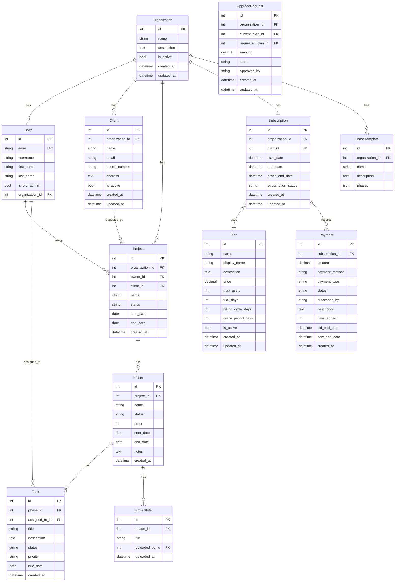

# 🗄️ Arquitectura de Base de Datos — ArcManager

Este documento describe las tablas principales, relaciones y decisiones de modelado. Incluye un diagrama ER (Mermaid) y artefactos para visualizar en herramientas externas (DBML y PlantUML).

## Diagrama ER (Mermaid)

## Explicación del modelo
- Multiorganización: `Organization` es el núcleo. Todas las entidades de negocio (`User`, `Client`, `Project`, `PhaseTemplate`, `Subscription`) referencian a la organización.
- Suscripciones: `Subscription` es 1:1 con `Organization` y referencia `Plan`. `Payment` guarda transacciones ligadas a la suscripción.
- Proyectos: `Project` pertenece a `Organization`, puede tener `owner` (usuario) y `client` opcional. Un proyecto tiene múltiples `Phase`, y cada `Phase` contiene `Task` y `ProjectFile`.
- Tareas: `Task` puede asignarse a un `User` (nullable) y está indexada por `status`, `priority`, `due_date`.
- Archivos: `ProjectFile` pertenece a `Phase` y guarda metadatos de subida.

Cardinalidades destacadas
- Organization→Subscription: 1:1 (única suscripción activa por organización).
- Organization→Project/Client/User/PhaseTemplate: 1:N.
- Project→Phase: 1:N; Phase→Task/ProjectFile: 1:N.
- Subscription→Payment: 1:N.

Políticas de borrado (resumen)
- `CASCADE`: `Project`→`Phase`→`Task/ProjectFile`, `Organization`→`Project/Client/PhaseTemplate/Subscription`.
- `SET_NULL`: `Project.owner`, `Task.assigned_to`, `Project.client`.
- `PROTECT`: `Subscription.plan`, `UpgradeRequest.(current_plan, requested_plan)`.

Índices y unicidad
- `User.email` único.
- `Client (organization, name)` único.
- `Project.status`, `Phase.status`, `Task.status/priority/due_date` indexados.
- `Subscription (subscription_status, end_date)` indexados.

## Visualización en programas externos

- Archivo DBML: `docs/tecnico/er/arcmanager.dbml`
  - Úsalo en `dbdiagram.io` (importar DBML) o en `https://dbdiagram.io` → Import → DBML.
  - También compatible con herramientas como `dbdocs`/`dbml-render`.

- Archivo PlantUML: `docs/tecnico/er/arcmanager.puml`
  - Visualízalo con el plugin de PlantUML (VSCode/IntelliJ) o con el jar de PlantUML.

Pasos rápidos
1) dbdiagram.io → Import → `arcmanager.dbml` → Render automático.
2) PlantUML: abre `arcmanager.puml` en un editor con soporte PlantUML y renderiza.

## Notas de implementación
- Nombres de tablas en inglés para consistencia.
- Revisa `settings.py` para `MEDIA_*` y `STATIC_*` en serving de archivos.
- Para producción, considerar S3 para `ProjectFile` y políticas de retención.
