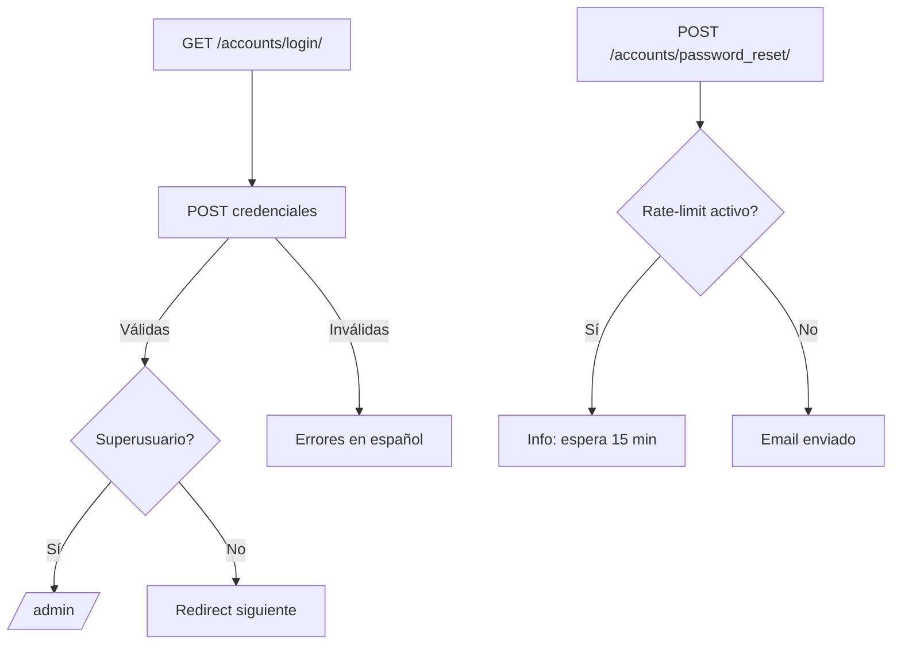

# 🌐 API y Endpoints — Módulo Accounts

## 🛣️ URLs y Routing

```python
# apps/accounts/urls.py
urlpatterns = [
    path('login/', CustomLoginView.as_view(...), name='login'),
    path('logout/', CustomLogoutView.as_view(), name='logout'),
    path('password_reset/', SecurePasswordResetView.as_view(...), name='password_reset'),
    path('password_reset/done/', PasswordResetDoneView.as_view(...), name='password_reset_done'),
    path('reset/<uidb64>/<token>/', PasswordResetConfirmView.as_view(...), name='password_reset_confirm'),
    path('reset/done/', PasswordResetCompleteView.as_view(...), name='password_reset_complete'),
]
```

---

## Endpoints Principales

- GET/POST `/accounts/login/`
  - Formulario de login con email+contraseña.
  - Superusuario → redirección directa a `/admin/` tras login.

- GET/POST `/accounts/logout/`
  - Limpia sesión y mensajes, registra auditoría, redirige a login.

- GET/POST `/accounts/password_reset/`
  - Rate-limit por email (15 min). Envío de instrucciones por correo.

- GET `/accounts/password_reset/done/`
- GET/POST `/accounts/reset/<uidb64>/<token>/`
- GET `/accounts/reset/done/`

---

## Flujos



---

## Mensajes y Respuestas

- Éxito login: redirect 302.
- Error login: 200 con mensajes localizados.
- Reset bloqueado: 200 con info y sin envío.

---

## Seguridad y Permisos

- Autenticación de sesión (Django).
- Middleware de acceso fuerza login en rutas no exentas (`LOGIN_EXEMPT_URLS`).
- Superusuarios limitados a `/admin/` para navegación.

---

Arc Manager · Accounts · Última actualización: 2025-08-13


