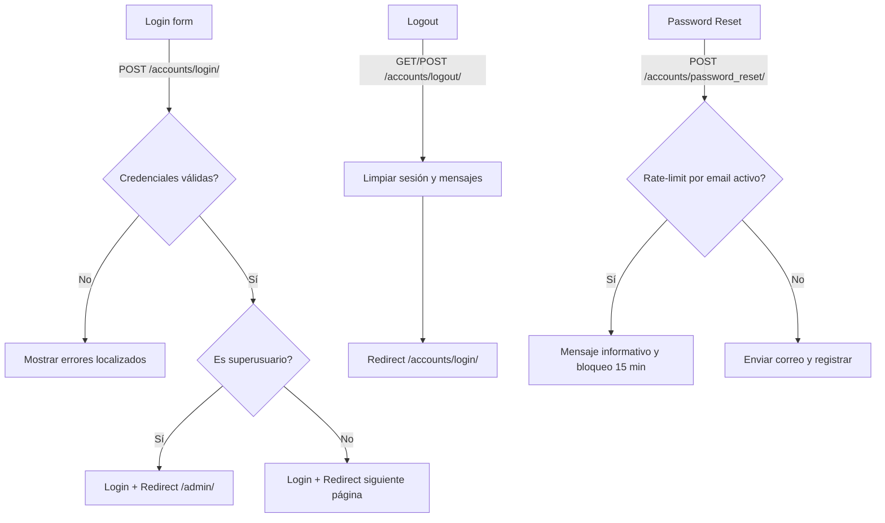

# 🔧 Implementación Técnica — Módulo Accounts

## 📋 Tabla de Contenidos
1. Arquitectura del Sistema
2. Modelo de Datos (`User`) y Manager
3. Señales (Signals)
4. Formularios (Forms)
5. Vistas/Controllers
6. URLs y Endpoints
7. Middleware
8. Templates y UX
9. Seguridad y Configuración
10. Logging y Auditoría
11. Optimización y Performance
12. Testing y Validación
13. Troubleshooting
14. Roadmap

---

## 🏗️ 1. Arquitectura del Sistema
- Usuario personalizado basado en `AbstractUser` con autenticación por correo (`email` como `USERNAME_FIELD`).
- Relación con `orgs.Organization` para multiorganización; banderas de rol `is_org_admin` y privilegios estándar (`is_staff`, `is_superuser`).
- Middleware de acceso global: requerir login y restringir superusuarios a `/admin/`.
- Vistas personalizadas para login/logout y recuperación de contraseña con rate-limiting por caché.
- Formularios con mensajes de error localizados.
- Administración avanzada en Django Admin con import/export y acciones masivas.

Diagrama de autenticación (alto nivel):

---

## 🗃️ 2. Modelo de Datos (`User`) y Manager
Archivo: `apps/accounts/models.py`

### 2.1 `CustomUserManager`
- `create_user(email, password, **extra_fields)`: normaliza email, setea contraseña, guarda.
- `create_superuser(...)`: fuerza `is_staff=True`, `is_superuser=True`, `is_active=True`.

### 2.2 `User` (extends `AbstractUser`)
- `username` (CharField, único, editable=False, autogenerado a partir de email + sufijo corto; solo compatibilidad):
  - Se genera en `save()` si está vacío; garantiza unicidad con intento y bucle.
- `email` (EmailField, único) usado como credencial principal (`USERNAME_FIELD='email'`).
- `first_name`, `last_name` requeridos (nombres visibles en UI).
- `is_org_admin` (BooleanField): rol administrativo a nivel de organización.
- `organization` (FK `orgs.Organization`, `SET_NULL`, `related_name='users'`): pertenencia opcional a una organización (ver reglas más abajo).
- `REQUIRED_FIELDS = ['first_name', 'last_name']`.
- Propiedades y helpers:
  - `full_name`, `username_display`, `role_display()`, `can_manage_users()`, `get_organization_name()`, `is_in_organization(org_id)`, `can_manage_organization()`.
- Restricciones (`Meta.constraints`):
  - `users_must_have_org_or_be_superuser_or_inactive`: usuarios activos deben tener organización, salvo superusuarios.
  - `unique_email`: unicidad por `email`.

---

## 🔔 3. Señales (Signals)
Archivo: `apps/accounts/signals.py` (registradas en `apps.py` → `ready()`)
- `validate_user_organization` (pre_save): si usuario está activo y no es superuser, debe tener `organization`.
- `validate_organization_limits` (pre_save): al crear usuario activo, consulta `organization.can_add_user()` y bloquea si supera límite.
- `ensure_names_present` (pre_save): si faltan nombres, los infiere del email (p. ej. `john.doe` → Nombre: John, Apellido: Doe).
- `validate_admin_without_org` (pre_save): `is_org_admin` requiere `organization` (salvo superuser).
- `log_user_creation` (post_save): registra en logger `arc_manager.users` la creación con rol y organización.

---

## 📝 4. Formularios (Forms)
Archivo: `apps/accounts/forms.py`
- `CustomAuthenticationForm` (extiende `AuthenticationForm`):
  - Campos con placeholders y clases CSS para el login.
  - Mensajes de error localizados en español (`invalid_login`, `inactive`).
  - `clean()` garantiza que los mensajes mostrados sean los localizados.

---

## 🎮 5. Vistas/Controllers
Archivo: `apps/accounts/views.py`

- `CustomLoginView(LoginView)`:
  - `template_name='auth/login.html'`, `authentication_form=CustomAuthenticationForm`.
  - `form_valid`: limpia flags de sesión relacionadas con mensajes de suscripción, registra login exitoso.
  - Si es superuser: realiza login y redirige directamente a `/admin/` (UI de app normal bloqueada por middleware).
  - `form_invalid`: log de intento fallido.

- `CustomLogoutView(View)`:
  - Acepta GET y POST, ambos llaman `logout_user`.
  - Registra datos del usuario antes de cerrar sesión.
  - Limpia flags de sesión y mensajes (consume el storage) y guarda la sesión limpia antes de `logout()`.
  - Redirige a `accounts:login`.

- `SecurePasswordResetView(PasswordResetView)`:
  - Templates: `auth/password_reset.html`, `auth/password_reset_email.html`, `auth/password_reset_subject.txt`.
  - `success_url='/accounts/password_reset/done/'` (o `reverse_lazy` desde urls).
  - Rate-limiting por cache: bloquea solicitudes repetidas por email durante 15 minutos (`cache.set(cache_key, True, timeout=900)`).
  - Muestra mensaje informativo si se reintenta antes del plazo.

---

## 🌐 6. URLs y Endpoints
Archivo: `apps/accounts/urls.py`

- `GET/POST /accounts/login/` → `CustomLoginView` (name: `accounts:login`).
- `GET/POST /accounts/logout/` → `CustomLogoutView` (name: `accounts:logout`).
- `GET/POST /accounts/password_reset/` → `SecurePasswordResetView` (name: `accounts:password_reset`).
- `GET /accounts/password_reset/done/` → `PasswordResetDoneView`.
- `GET/POST /accounts/reset/<uidb64>/<token>/` → `PasswordResetConfirmView`.
- `GET /accounts/reset/done/` → `PasswordResetCompleteView`.

---

## 🧱 7. Middleware
Archivo: `apps/accounts/middleware.py`

- `LoginRequiredMiddleware`:
  - Redirige a `LOGIN_URL` con `?next=...` si el usuario no está autenticado y la URL no está en `LOGIN_EXEMPT_URLS` (regex).
  - Si está autenticado, recarga el `request.user` con `select_related('organization')` para optimizar accesos posteriores.

- `SuperuserRestrictMiddleware`:
  - Si el usuario es superuser, permite solo rutas `admin/`, `accounts/login`, `accounts/logout`, `static/`, `media/`.
  - Primera visita a `/admin/` muestra un mensaje de bienvenida (solo una vez por sesión).
  - Cualquier otra ruta de la app redirige a `/admin/`.

- `ErrorHandlingMiddleware` (producción):
  - Registra errores no manejados (stacktrace) y devuelve `templates/500.html` o HTML de fallback.

Orden recomendado en settings: `Security`, `WhiteNoise`, `Session`, `Authentication`, `Message`, `Axes`, `LoginRequiredMiddleware`, `SuperuserRestrictMiddleware`, `OrganizationContextMiddleware`, `ErrorHandlingMiddleware`.

---

## 🎨 8. Templates y UX
- `templates/auth/login.html`: formulario de login con mensajes claros en español.
- `templates/auth/password_reset.html` + `password_reset_email.html` + `password_reset_subject.txt`.
- Estados de mensajes del sistema integrados con `messages` de Django.

---

## 🔐 9. Seguridad y Configuración
- Autenticación por email (`USERNAME_FIELD='email'`).
- Restricciones y señales impiden usuarios activos sin organización (salvo superusers) y administradores sin organización.
- Rate-limiting de password reset por caché (requiere `CACHES` funcional; Redis recomendado en producción).
- Configuración clave (ejemplos):
  - `AUTH_USER_MODEL = 'accounts.User'`.
  - `LOGIN_URL = '/accounts/login/'`.
  - `LOGIN_EXEMPT_URLS = [r'^accounts/login/$', r'^accounts/password_reset/.*$', r'^reset/.*$', r'^admin/.*$', r'^static/.*$', r'^media/.*$']`.
  - Email backend/credenciales para envío de reset (por ejemplo Amazon SES) definidos por variables de entorno.
- Integración opcional: `django-axes` para limitar intentos de login (configurado a nivel de settings y middleware global del proyecto).

---

## 🧾 10. Logging y Auditoría
- `CustomLoginView`: registra logins exitosos y fallidos (incluye rol y organización).
- `CustomLogoutView`: registra evento con usuario/rol/organización.
- Signals: `log_user_creation` registra toda creación de usuario.
- `ErrorHandlingMiddleware`: registra excepciones no manejadas en producción con contexto.

---

## ⚡ 11. Optimización y Performance
- Precarga de organización en `LoginRequiredMiddleware` con `select_related` para evitar queries repetidas en vistas.
- Limpieza de flags de sesión para evitar acumulación de mensajes y estados.
- Uso de cache en password reset para rate-limiting eficiente.

---

## 🧪 12. Testing y Validación
Casos sugeridos:
- Modelo `User`:
  - Creación con email único y nombres obligatorios; generación automática de `username`.
  - Constraint `users_must_have_org_or_be_superuser_or_inactive`.
  - Señales: creación de usuario sin `organization` activo debe fallar; admin sin org debe fallar; límite de `organization.can_add_user()` aplicado.
- Login/Logout:
  - Login correcto (redirige a `next` o dashboard), superuser redirige a `/admin/`.
  - Login incorrecto muestra mensaje localizado; se registra WARNING.
  - Logout limpia sesión y mensajes; redirige a login.
- Password Reset:
  - Primer POST permite envío; segundo POST en <15min bloqueado con mensaje.
- Middleware:
  - Rutas protegidas redirigen cuando no autenticado.
  - Superuser bloqueado fuera de `/admin/`.

---

## 🛠️ 13. Troubleshooting
- No puedo iniciar sesión: verificar email/contraseña, estado `is_active`, intentos bloqueados por Axes.
- Superusuario ve la app en lugar de admin: revisar orden del `SuperuserRestrictMiddleware`.
- Password reset no envía correos: revisar backend de email, variables de entorno y logs.
- Bucle de redirecciones: revisar `LOGIN_EXEMPT_URLS` y `LOGIN_URL`.

---

## 🗺️ 14. Roadmap
- 2FA (TOTP) opcional por organización/usuario.
- Recordatorios de dispositivos y cierre de sesión remota.
- Auditoría avanzada: historial de inicios de sesión por IP/UA.
- Captcha opcional tras varios intentos fallidos (además de Axes).
