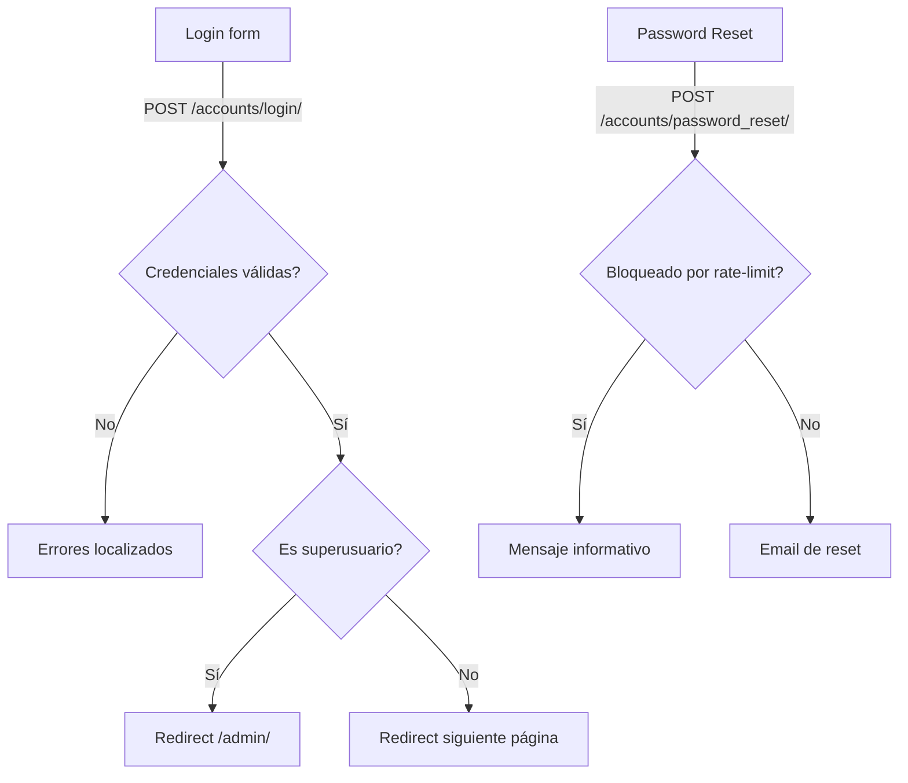

## 📚 Documentación del Módulo Accounts - Arc Manager

### 🎯 Bienvenido

Esta es la documentación completa del módulo **Accounts**. Gestiona la autenticación por email, el modelo de usuario personalizado, validaciones con señales, middleware de acceso y la administración de usuarios.

---

## 📖 Documentos Disponibles

- 🏠 README.md — Descripción general y arquitectura
- 🔧 IMPLEMENTACION_TECNICA.md — Detalle técnico profundo
- 🌐 API_ENDPOINTS.md — URLs, flujos y ejemplos
- 📝 CHANGELOG.md — Historial de cambios

---

## 🚀 Inicio Rápido

### Para Desarrolladores
1. Lee `README.md` para entender el flujo de autenticación y el modelo `User`.
2. Revisa `IMPLEMENTACION_TECNICA.md` para detalles de señales, middleware y admin.
3. Consulta `API_ENDPOINTS.md` para integrar formularios de login y reset de contraseña.

### Para Administradores
1. Accede con superusuario y serás redirigido automáticamente a `/admin/`.
2. Usa acciones masivas en el admin (activar/desactivar, admin de org, reenviar bienvenida).

### Para Soporte/QA
1. Verifica `LOGIN_EXEMPT_URLS` y orden de middleware si ves bucles de redirección.
2. Revisa rate-limiting de reset de contraseña (cache 15 min por email).

---

## 🏗️ Arquitectura General

---

## 🔐 Permisos y Middleware

- `LoginRequiredMiddleware`: fuerza autenticación y precarga `organization` con `select_related`.
- `SuperuserRestrictMiddleware`: superusuarios solo pueden navegar `/admin/` (app principal bloqueada).
- Señales garantizan: usuarios activos deben tener `organization` (salvo superusers) y admin de org requiere `organization`.

---

## 🔗 Enlaces Útiles

- Django Auth — `https://docs.djangoproject.com/en/stable/topics/auth/`
- Django Admin — `https://docs.djangoproject.com/en/stable/ref/contrib/admin/`
- django-axes — `https://django-axes.readthedocs.io/`

---

Arc Manager · Módulo Accounts · Última actualización: 2025-08-13

