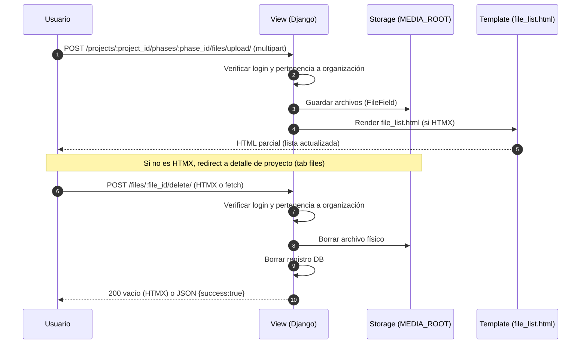

# 🔧 Implementación Técnica — Módulo Files

## 📋 Tabla de Contenidos
1. Arquitectura del Sistema
2. Modelos y Campos
3. Administración (Admin)
4. Vistas/Controllers
5. URLConf y Middlewares
6. Plantillas y JavaScript
7. Seguridad
8. Performance
9. Logging
10. Testing sugerido
11. Troubleshooting
12. Métricas y mejoras futuras

---

## 🏗️ 1. Arquitectura del Sistema
- Módulo simple orientado a adjuntar archivos a `projects.Phase`.
- Persistencia mediante `FileField` con `upload_to=project_file_path` para estructurar por organización/proyecto/fase.
- Operaciones: `upload_file` y `delete_file`, protegidas por login y validadas por organización.
- Render parcial con HTMX para UX fluida en el detalle del proyecto.

Diagrama de flujo (alto nivel):
```mermaid
flowchart TD
  subgraph UI/Templates
    A[_files_tab.html]
  end
  subgraph Views
    B(upload_file)
    C(delete_file)
  end
  subgraph Models/Storage
    D(ProjectFile)
    E(MEDIA_ROOT)
  end

  A -->|POST files[]| B -->|create| D --> E
  A -->|POST delete| C -->|delete| D
  B -->|HTMX partial| A
  C -->|HTMX 200 vacío| A
```

---

## 🗃️ 2. Modelos y Campos
Archivo: `apps/files/models.py`

```python
class ProjectFile(models.Model):
    phase = models.ForeignKey(Phase, on_delete=models.CASCADE, related_name='files', verbose_name=_('Phase'))
    file = models.FileField(_('File'), upload_to=project_file_path)
    uploaded_by = models.ForeignKey(settings.AUTH_USER_MODEL, on_delete=models.SET_NULL, null=True, blank=True, verbose_name=_('Uploaded By'))
    uploaded_at = models.DateTimeField(_('Upload Date'), auto_now_add=True)

    class Meta:
        verbose_name = _('Project File')
        verbose_name_plural = _('Project Files')
        ordering = ['-uploaded_at']

    @property
    def size(self): ...
    @property
    def filename(self): ...
    @property
    def extension(self): ...
```

- `project_file_path(instance, filename)` genera la ruta:
  `organizations/<org_id>/projects/<project_id>/phases/<phase_id>/<filename>`
- Helpers: `size` (bytes), `filename` (basename) y `extension` (en mayúsculas, sin punto).

Migraciones:
- `0001_initial.py`: crea `ProjectFile` con campos básicos (`file`, `uploaded_at`).
- `0002_initial.py`: añade FK `phase` y `uploaded_by`.

---

## 🧑‍💼 3. Administración (Admin)
- `apps/files/admin.py` no registra aún `ProjectFile`. No hay listados, filtros ni acciones personalizadas.
  - Posible mejora: registrar modelo con columnas `filename`, `phase`, `uploaded_by`, `uploaded_at` y filtros por `phase__project`.

---

## 🎮 4. Vistas/Controllers
Archivo: `apps/files/views.py`

### 4.1 `upload_file(request, project_id, phase_id)`
- Decoradores: `@login_required`, `@require_POST`.
- Obtiene `Phase` por `phase_id` y `project_id`.
- Seguridad organizacional: compara `request.user.organization` con `phase.project.organization`.
- Valida que existan archivos en `request.FILES.getlist('files')`.
- Crea `ProjectFile` por cada archivo; setea `uploaded_by`.
- Respuesta:
  - HTMX (`HX-Request: true`): renderiza `projects/partials/file_list.html` con `{'files': phase.files.all()}`.
  - Normal: redirige a `projects:project-detail?tab=files#files`.

### 4.2 `delete_file(request, file_id)`
- Decoradores: `@login_required`, `@require_POST`.
- Recupera `ProjectFile` y valida organización.
- Elimina primero el archivo físico (`file.delete(save=False)`) y luego la fila de BD.
- Respuesta:
  - HTMX: 200 con cuerpo vacío (para `hx-swap='outerHTML'`).
  - Normal: JSON `{"success": true, "id": file_id}`.

---

## 🛣️ 5. URLConf y Middlewares
Archivo: `apps/files/urls.py`

- `POST projects/<int:project_id>/phases/<int:phase_id>/files/upload/` → `upload_file`
- `POST files/<int:file_id>/delete/` → `delete_file`

Middlewares relevantes en `core/settings.py`:
- `AuthenticationMiddleware` (Django)
- `apps.accounts.middleware.LoginRequiredMiddleware` (requiere login global)
- `apps.orgs.middleware.OrganizationContextMiddleware` (contexto de organización para vistas)

---

## 🖼️ 6. Plantillas y JavaScript
- `projects/partials/_files_tab.html`:
  - Cabecera y acordeón por fase (`phases` proviene de la vista de detalle de proyecto).
  - Form de subida con `multiple` y `csrf_token`; acción a `files:upload_file`.
  - Tabla `file_list` con columnas: Archivo (icono por `extension` + `filename`), Tipo, Subido por, Fecha, Tamaño, Acciones.
  - Botón Descargar (`href=file.file.url`) y botón Eliminar con HTMX (`hx-post`, `hx-target`, `hx-swap='outerHTML'`).
- `projects.js` no implementa lógica específica para archivos; sí gestiona activación de pestañas incluyendo `?tab=files` y `#files`.
- Parcial `projects/partials/file_list.html` es renderizado por `upload_file` para actualizaciones HTMX.

---

## 🔐 7. Seguridad
- Autenticación obligatoria en todas las operaciones.
- Autorización por organización: se compara la organización del usuario con la del proyecto de la fase/archivo.
- CSRF: el form de subida incluye ``.
- Descargas: accesibles por URL directa `file.url`. En entornos donde `/media/` sea público, cualquier usuario con el enlace podría acceder si conoce la URL; se recomienda proteger rutas privadas detrás de vistas firmadas si se requiere mayor control.
- Validaciones de tamaño/extensión: no hay validaciones server-side actualmente. Considerar límites y extensiones permitidas.

---

## ⚡ 8. Performance
- Almacenamiento en filesystem bajo `MEDIA_ROOT`; acceso directo para descargas.
- Consultas: el acceso a `phase.files.all` es simple; para listados extensos, considerar paginación o límites por fase.
- Considerar `select_related('uploaded_by', 'phase__project')` en listados si se crea una vista dedicada.
- Eliminaciones borran el archivo físico antes de borrar la fila, evitando huérfanos.

---

## 🧾 9. Logging
- Las vistas actuales no registran explícitamente logs de subida/eliminación.
- Recomendación: usar logger `apps.files` para eventos `upload` y `delete` con `user_id`, `org_id`, `project_id`, `phase_id`, `filename`, `size`.

---

## 🧪 10. Testing sugerido
- Modelos:
  - Crear `ProjectFile` con fase de otra organización debe ser imposible vía vistas (probar vistas, no el modelo).
  - Propiedades `filename` y `extension` retornan valores correctos.
- Vistas:
  - `upload_file` requiere login; 403 si `user.organization` ≠ `phase.project.organization`.
  - 400 si no se envían archivos.
  - Envío HTMX regresa parcial con filas que incluyen los nuevos archivos.
  - `delete_file` borra archivo físico y regresa 200 vacío (HTMX) o JSON en llamada normal.
- UI básica:
  - `_files_tab.html` muestra conteo `phase.files.count` correcto.
  - Botón Eliminar remueve la fila con `hx-swap='outerHTML'`.

---

## 🛠️ 11. Troubleshooting
- Archivos no se guardan: verificar permisos de escritura en `MEDIA_ROOT` y que la ruta exista.
- Descargas 404: confirmar que las URLs `/media/` estén servidas en el entorno actual (en desarrollo: `django.views.static.serve` o `runserver`; en producción: servidor web).
- 403 al subir/eliminar: confirmar que el usuario pertenezca a la organización del proyecto/fase.
- Respuesta HTMX inesperada: confirmar cabecera `HX-Request` y plantilla `file_list.html` disponible.

---

## 📈 12. Métricas y mejoras futuras
- Versionado de archivos (histórico por fase/proyecto, con `current` flag).
- Etiquetas y metadatos adicionales (descripción, tipo lógico, autor).
- Previsualización (thumbnails para imágenes, visor PDF embebido, iconos para CAD).
- Antivirus/antimalware al subir (clamav o servicio externo) y validación de extensión/MIME.
- Límites de tamaño por plan u organización y cuota de almacenamiento.
- Descargas firmadas/temporales para mayor seguridad.

---

Arc Manager · Módulo Files · Última actualización: 2025-08-13

# 🔧 Implementación Técnica — Módulo Files

## 📋 Tabla de Contenidos
1. Arquitectura del Sistema
2. Modelo de Datos y Rutas de Almacenamiento
3. Flujos de Negocio (HTMX y no-HTMX)
4. Vistas/Controllers detalladas
5. Endpoints y URLs
6. Templates y Componentes de Frontend
7. Permisos y Seguridad
8. Validaciones y Límites de Subida
9. Rendimiento y Optimización
10. Testing y Validación
11. Troubleshooting
12. Roadmap de Mejoras

---

## 🏗️ 1. Arquitectura del Sistema
- Propósito: gestionar archivos asociados a fases de proyectos (por organización).
- Alcance: subida, listado, descarga (serving por `MEDIA_URL`), y eliminación de archivos.
- Integración:
  - Relación fuerte con `apps.projects` (modelo `Phase`).
  - Uso de `FileField` con `upload_to` dinámico por Organización/Proyecto/Fase.
  - Vistas con control de acceso por organización y soporte HTMX.

Diagrama de alto nivel (subida y eliminación):


---

## 🗃️ 2. Modelo de Datos y Rutas de Almacenamiento
Archivo: `apps/files/models.py`

### 2.1 Modelo `ProjectFile`
- Campos:
  - `phase`: FK a `Phase` (CASCADE) con `related_name='files'`.
  - `file`: `FileField` con `upload_to=project_file_path`.
  - `uploaded_by`: FK a `User` (SET_NULL, nullable) — preserva registros si el usuario se elimina.
  - `uploaded_at`: `DateTimeField(auto_now_add=True)`.
- Metadatos:
  - `ordering = ['-uploaded_at']` (últimos primero).
  - `verbose_name(_plural)` internacionalizados.
- Utilidades:
  - `size`: tamaño del archivo (bytes) si está disponible.
  - `filename`: nombre base sin ruta.
  - `extension`: extensión en mayúsculas sin punto (p.ej., PDF, JPG).

### 2.2 Función `project_file_path(instance, filename)`
- Estructura de ruta generada:
  - `organizations/<org_id>/projects/<project_id>/phases/<phase_id>/<filename>`
- Ventajas:
  - Aísla archivos por organización/proyecto/fase.
  - Facilita auditorías y limpieza selectiva.

### 2.3 Almacenamiento y serving
- Requiere `MEDIA_ROOT` y `MEDIA_URL` configurados en settings.
- En desarrollo, Django puede servir `MEDIA_URL` con `DEBUG=True`.
- En producción, servir medios detrás de un servidor/objeto (Nginx, S3, etc.).

---

## 🎯 3. Flujos de Negocio (HTMX y no-HTMX)
- Subida (HTMX):
  - POST multipart a endpoint de subida.
  - Tras crear registros, la vista renderiza `projects/partials/file_list.html` con `files` de la fase.
  - El frontend reemplaza la lista del DOM sin recargar toda la página.
- Subida (no-HTMX):
  - Tras cargar archivos, redirige al detalle del proyecto con `?tab=files#files`.
- Eliminación (HTMX):
  - POST a endpoint de eliminación con `hx-post`, `hx-target` y `hx-swap=outerHTML`.
  - Respuesta 200 vacía para que HTMX remueva la fila/tarjeta.
- Eliminación (Fetch/normal):
  - Respuesta JSON `{success: true, id: <file_id>}`.

---

## 🎮 4. Vistas/Controllers detalladas
Archivo: `apps/files/views.py`

### 4.1 `upload_file(request, project_id, phase_id)`
- Decoradores: `@login_required`, `@require_POST`.
- Autorización: rechaza 403 si `request.user.organization != phase.project.organization`.
- Validación: requiere `request.FILES.getlist('files')` (si falta, 400 + mensaje).
- Proceso:
  - Crea `ProjectFile` por cada archivo con `phase` y `uploaded_by`.
- Respuesta:
  - HTMX: render parcial `projects/partials/file_list.html` con `files = phase.files.all()`.
  - No-HTMX: redirect a `projects:project-detail` con `?tab=files#files`.

### 4.2 `delete_file(request, file_id)`
- Decoradores: `@login_required`, `@require_POST`.
- Autorización: 403 si el archivo no pertenece a la organización del usuario.
- Proceso:
  - `project_file.file.delete(save=False)` para borrar el archivo físico.
  - `project_file.delete()` para borrar el registro.
- Respuesta:
  - HTMX: 200 con cuerpo vacío (se remueve en el DOM).
  - JSON para otras llamadas.

---

## 🌐 5. Endpoints y URLs
Archivo: `apps/files/urls.py`

- `POST /projects/<int:project_id>/phases/<int:phase_id>/files/upload/` → `upload_file` (name: `files:upload_file`).
- `POST /files/<int:file_id>/delete/` → `delete_file` (name: `files:delete_file`).

Notas
- Los paths están bajo `app_name='files'`.
- La subida se invoca desde vistas de proyecto; la eliminación desde listados parciales.

---

## 🎨 6. Templates y Componentes de Frontend
- Pestaña de archivos del proyecto: `apps/projects/templates/projects/partials/_files_tab.html`:
  - Renderiza acordeón por fase con formulario de subida (multiple) por fase.
  - Lista archivos con iconos por tipo (PDF, imágenes, CAD, Office, etc.).
  - Botón Eliminar con HTMX:
    - `hx-post=""`
    - `hx-target="#file-{{ file.id }}"` y `hx-swap="outerHTML"`.
- Parcial de lista (para HTMX): `apps/projects/templates/projects/partials/file_list.html`:
  - Grid de tarjetas con preview simple (imagen si termina en .jpg/.jpeg/.png/.gif).
  - Botón Eliminar con HTMX y confirmación i18n.

---

## 🔐 7. Permisos y Seguridad
- Autenticación obligatoria en ambos endpoints (decorador `login_required`).
- Autorización por organización: se compara la `organization` del usuario con la del proyecto/fase del archivo.
- Actualmente no hay distinción por rol: cualquier usuario de la organización puede subir/eliminar. Si se desea, puede restringirse a `is_org_admin` agregando un mixin/decorador o verificación extra.
- Eliminación segura: primero se borra el archivo físico y luego el registro, evitando huérfanos.
- Rutas de almacenamiento segregadas por organización reducen el riesgo de fuga entre tenants.

Recomendaciones (futuras)
- Validar tipos MIME en servidor.
- Límite de tamaño por archivo y por fase/proyecto.
- Antivirus/antimalware en pipeline de subida si se procesan ejecutables.

---

## 🛡️ 8. Validaciones y Límites de Subida
Estado actual
- Requiere al menos un archivo en `request.FILES`.
- No hay validación de tamaño/extensión al servidor (solo UI mínima).

Sugerencias
- Configurar en settings límites, por ejemplo:
  - `MAX_FILE_SIZE_MB = 25`
  - `ALLOWED_CONTENT_TYPES = {'application/pdf', 'image/jpeg', 'image/png', ...}`
- Validar en `upload_file` y devolver mensajes claros.
- Limitar total de archivos por fase si es un requerimiento de negocio.

---

## ⚡ 9. Rendimiento y Optimización
- Prefetch en vistas de proyecto: `ProjectDetailView` usa `prefetch_related('files', 'files__uploaded_by')` para reducir queries.
- Render parcial con HTMX evita recargas completas.
- Sugerencias:
  - Paginación/carga diferida si hay muchos archivos.
  - Thumbnails para imágenes grandes.
  - Offloading a almacenamiento externo (S3) para escalabilidad.

---

## 🧪 10. Testing y Validación
Casos clave sugeridos
- Subida exitosa (HTMX y no-HTMX):
  - Crea registros y devuelve parcial o redirect.
- Permisos por organización:
  - Usuario de otra organización recibe 403 en upload y delete.
- Eliminación:
  - Borra archivo físico y registro; HTMX retorna cuerpo vacío; JSON retorna `{success:true}`.
- Plantillas:
  - `_files_tab.html` muestra conteo correcto por fase y renderiza iconos por extensión.

Ejemplos de asserts
- `self.client.post(upload_url, files=..., HTTP_HX_REQUEST='true')` y verificar que contiene tarjetas o filas esperadas.
- Verificar que `default_storage.exists(path)` es `False` tras eliminar.

---

## 🛠️ 11. Troubleshooting
- 404 al acceder a archivos:
  - Verificar `MEDIA_URL` y `MEDIA_ROOT`; en dev, usar `DEBUG=True` o servir media con Nginx.
- Archivos no aparecen tras subir:
  - Confirmar que el formulario apunte al URL correcto y que la fase existe.
  - Revisar mensajes del sistema y logs.
- HTMX no actualiza la lista:
  - Revisar cabecera `HX-Request` en la solicitud.
  - Confirmar `hx-target`/`hx-swap` correctos y que el parcial renderiza `id`/selectores esperados.

---

## 🗺️ 12. Roadmap de Mejoras
- Validación de tipos/tamaños en servidor y feedback en UI.
- Barra de progreso de subida (JS) por archivo.
- Previsualizaciones enriquecidas y thumbnails.
- Almacenamiento en S3 con URLs firmadas y expiración configurable.
- Auditoría: logging de eventos (subida/eliminación) y usuario responsable.
- Cuotas por proyecto/fase/organización y alertas por umbral.
