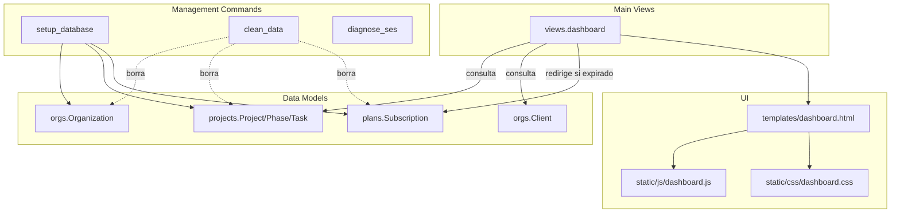

## 📚 Documentación del Módulo Main

### Documentos disponibles

- README.md — Descripción general y arquitectura
- IMPLEMENTACION_TECNICA.md — Detalle técnico profundo
- API_ENDPOINTS.md — URLs y flujos con ejemplos
- CHANGELOG.md — Historial de cambios

---

### 🚀 Inicio rápido por rol

- **Desarrolladores**
  - Verifica que `apps.main` esté en `INSTALLED_APPS` y las URLs incluidas en `core/urls.py` (`path('main/', include('apps.main.urls'))`).
  - Ejecuta inicialización local (migraciones + superusuario + planes):
    - `docker compose exec web python manage.py setup_database` (o `--force` si deseas continuar ante errores)
  - Abre `/main/` para el dashboard autenticado.

- **Administradores**
  - Limpieza total del entorno de prueba:
    - `docker compose exec web python manage.py clean_data --yes`
  - Diagnóstico de correo (Amazon SES):
    - `docker compose exec web python manage.py diagnose_ses --test-email you@example.com`

- **Soporte/QA**
  - Revisa el redirect raíz y autenticación: `/` → `main:dashboard` cuando autenticado; si no, a `accounts:login`.
  - Health check (nivel proyecto, no del módulo): `/health/`.
  - Valida expiración de suscripción: el dashboard redirige a `plans:subscription_dashboard` si `organization.subscription.is_expired`.

---

### 🏗️ Diagrama (alto nivel)

---

Arc Manager · Módulo Main

