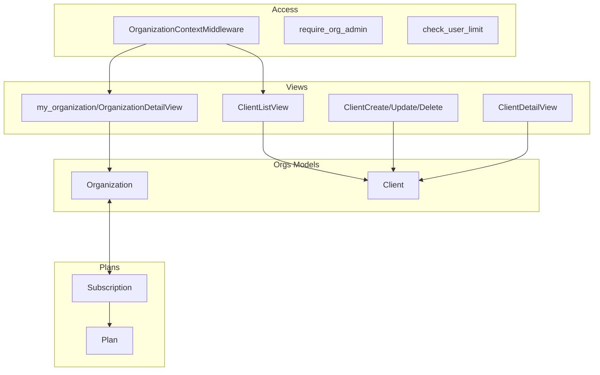

## 📚 Documentación del Módulo Orgs

### Documentos disponibles

- README.md — Descripción general y arquitectura
- IMPLEMENTACION_TECNICA.md — Detalle técnico profundo
- API_ENDPOINTS.md — URLs y flujos con ejemplos
- CHANGELOG.md — Historial de cambios

---

### 🚀 Inicio rápido por rol

- **Desarrolladores**
  - Verifica `apps.orgs` en `INSTALLED_APPS` y rutas incluidas en `core/urls.py` (`path('organizations/', include('apps.orgs.urls'))`).
  - Crea datos de ejemplo:
    - `docker compose exec web python manage.py setup_database`
    - `docker compose exec web python manage.py setup_demo_data --orgs 2 --users-per-org 3`
  - Abre `/organizations/clients/` para CRUD de clientes y `/organizations/mi-organizacion/` para el panel de organización.

- **Administradores**
  - Administra `Organization` y `Client` en `/admin/` con import/export.
  - Revisa estado de suscripción desde el admin con enlaces a `plans.Subscription`.

- **Soporte/QA**
  - Comando de limpieza y saneamiento multitenant:
    - `docker compose exec web python manage.py clean_tenant_data --all --yes`
  - Listado y diagnóstico de organizaciones/usuarios:
    - `docker compose exec web python manage.py list_orgs --detailed`

---

### 🏗️ Diagrama (alto nivel)

---

Arc Manager · Módulo Orgs

