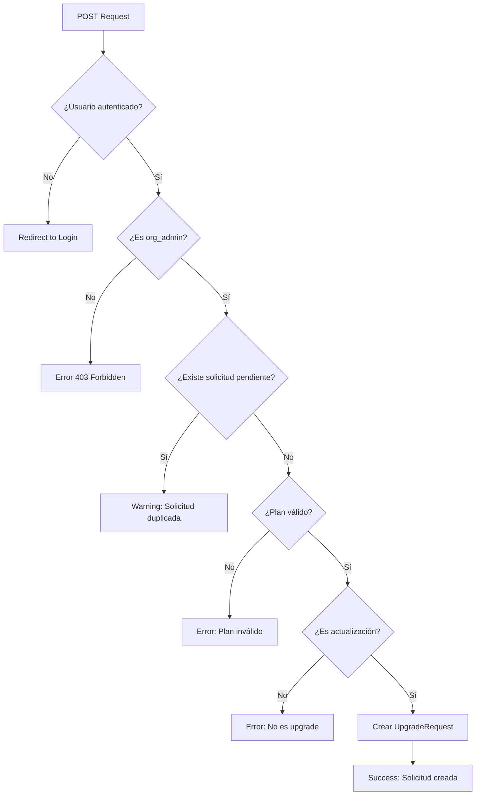

# 🌐 API y Endpoints - Módulo de Planes

## 📋 Tabla de Contenidos

1. [URLs y Routing](#urls-y-routing)
2. [Endpoints Principales](#endpoints-principales)
3. [Respuestas y Formatos](#respuestas-y-formatos)
4. [Autenticación y Permisos](#autenticación-y-permisos)
5. [Ejemplos de Uso](#ejemplos-de-uso)
6. [Códigos de Error](#códigos-de-error)
7. [API REST (Futuro)](#api-rest-futuro)

---

## 🛣️ URLs y Routing

### **Configuración Principal**

```python
# arc_manager/apps/plans/urls.py

from django.urls import path
from . import views
from django.contrib.auth.decorators import login_required

app_name = 'plans'

def plan_redirect_view(request):
    """
    Función de redirección inteligente basada en el rol del usuario.
    
    Lógica de redirección:
    - No autenticado → Login
    - Superusuario → Admin de Django
    - Usuario normal → Dashboard de suscripción
    """
    user = request.user
    if not user.is_authenticated:
        return redirect('accounts:login')
    
    if user.is_superuser:
        return redirect('/admin/plans/upgraderequest/')
    
    return redirect('plans:subscription_dashboard')

urlpatterns = [
    # Redirección principal
    path('', login_required(plan_redirect_view), name='index'),
    
    # Dashboard de suscripción
    path('dashboard/', views.SubscriptionDashboardView.as_view(), name='subscription_dashboard'),
    
    # Solicitud de actualización
    path('solicitar-actualizacion/', views.RequestUpgradeView.as_view(), name='request_upgrade'),
]
```

### **URLs Completas del Sistema**

| URL | Método | Vista | Permisos | Propósito |
|-----|--------|-------|----------|-----------|
| `/plans/` | GET | `plan_redirect_view` | Autenticado | Redirección inteligente |
| `/plans/dashboard/` | GET | `SubscriptionDashboardView` | Autenticado | Dashboard principal |
| `/plans/solicitar-actualizacion/` | GET/POST | `RequestUpgradeView` | OrgAdmin | Gestión de actualizaciones |

---

## 🎯 Endpoints Principales

### **1. Dashboard de Suscripción**

#### **GET /plans/dashboard/**

**Propósito:** Muestra el dashboard principal de gestión de suscripción.

**Permisos requeridos:**
- Usuario autenticado
- Debe pertenecer a una organización

**Parámetros:** Ninguno

**Respuesta:** Renderiza template con contexto completo

**Contexto proporcionado:**
```python
{
    'subscription': Subscription,      # Suscripción actual
    'organization': Organization,      # Organización del usuario
    'is_org_admin': bool,             # Permisos de administrador
    'pending_request': UpgradeRequest, # Solicitud pendiente (si existe)
    'available_plans': QuerySet,      # Planes disponibles para actualizar
}
```

**Estados posibles:**
- **Sin organización:** Muestra mensaje de error
- **Plan gratuito:** Muestra motivador de actualización
- **Solicitud pendiente:** Muestra estado de proceso
- **Plan activo:** Muestra información y opciones

---

### **2. Solicitud de Actualización**

#### **GET /plans/solicitar-actualizacion/**

**Propósito:** Muestra la página de selección y comparación de planes.

**Permisos requeridos:**
- Usuario autenticado
- Administrador de organización (`is_org_admin = True`)

**Respuesta:** Renderiza template con opciones de planes

**Contexto proporcionado:**
```python
{
    'subscription': Subscription,        # Suscripción actual
    'has_pending_request': bool,        # Indica si hay solicitud pendiente
    'pending_request': UpgradeRequest,  # Solicitud pendiente (si existe)
    'available_plans': QuerySet,       # Planes disponibles (si no hay solicitud)
}
```

**Estados de vista:**
1. **Solicitud pendiente:** Muestra estado y timeline
2. **Sin solicitud:** Muestra grid de comparación de planes
3. **Sin planes disponibles:** Mensaje informativo

---

#### **POST /plans/solicitar-actualizacion/**

**Propósito:** Procesa la solicitud de actualización de plan.

**Permisos requeridos:**
- Usuario autenticado
- Administrador de organización

**Parámetros del formulario:**
```python
{
    'requested_plan': int,    # ID del plan solicitado (requerido)
    'notes': str,            # Notas adicionales del usuario (opcional)
    'csrfmiddlewaretoken': str # Token CSRF (requerido)
}
```

**Validaciones realizadas:**
1. **Usuario autenticado** y con permisos de org_admin
2. **No existe solicitud pendiente** para la organización
3. **Plan solicitado existe** y está activo
4. **Es una actualización** (precio mayor al plan actual)

**Respuestas posibles:**

| Caso | Redirección | Mensaje |
|------|-------------|---------|
| Éxito | `/plans/dashboard/` | "Solicitud enviada exitosamente" |
| Solicitud duplicada | `/plans/dashboard/` | "Ya tienes una solicitud pendiente" |
| Plan inválido | `/plans/solicitar-actualizacion/` | "El plan seleccionado no es válido" |
| No es actualización | `/plans/solicitar-actualizacion/` | "Solo puedes actualizar a un plan de mayor valor" |
| Error del sistema | `/plans/solicitar-actualizacion/` | "Error al procesar solicitud" |

**Flujo de procesamiento:**


---

## 📋 Respuestas y Formatos

### **Mensajes del Sistema**

#### **Mensajes de Éxito**
```python
messages.success(
    request,
    f"Tu solicitud de actualización a {plan.display_name} ha sido enviada. "
    "Recibirás instrucciones de pago una vez que sea aprobada."
)
```

#### **Mensajes de Advertencia**
```python
messages.warning(
    request,
    "Ya tienes una solicitud de actualización pendiente."
)
```

#### **Mensajes de Error**
```python
messages.error(
    request,
    "Solo puedes actualizar a un plan de mayor valor."
)
```

### **Templates de Respuesta**

#### **Dashboard (subscription_dashboard.html)**
```html
<!-- Estructura principal -->
<div class="page-container">
    <div class="header-section">
        <!-- Header con información del plan -->
    </div>
    
    <div class="main-content-grid">
        <div class="left-content">
            <!-- Contenido principal -->
            
                <!-- Estado de solicitud pendiente -->
            
                <!-- Motivador para plan gratuito -->
            
            
            <!-- Cards informativos -->
        </div>
        
        <div class="right-sidebar">
            <!-- Acciones y planes disponibles -->
        </div>
    </div>
</div>
```

#### **Solicitud de Actualización (request_upgrade.html)**
```html

    <!-- Vista de solicitud pendiente -->
    <div class="pending-request-hero">
        <!-- Estado actual de la solicitud -->
    </div>

    <!-- Vista de selección de planes -->
    <form method="post" class="upgrade-form">
        
        <div class="plans-grid">
            <!-- Plan actual + planes disponibles -->
        </div>
        <button type="submit">Solicitar Actualización</button>
    </form>

```

---

## 🔐 Autenticación y Permisos

### **Middleware de Autenticación**

```python
# Configuración en settings.py
MIDDLEWARE = [
    'django.middleware.security.SecurityMiddleware',
    'django.contrib.sessions.middleware.SessionMiddleware',
    'django.contrib.auth.middleware.AuthenticationMiddleware',  # Requerido
    'apps.orgs.middleware.OrganizationMiddleware',              # Custom
    # ... otros middleware
]
```

### **Decoradores de Permisos**

#### **@login_required**
```python
from django.contrib.auth.decorators import login_required

# Aplicado automáticamente a todas las vistas
urlpatterns = [
    path('dashboard/', login_required(views.SubscriptionDashboardView.as_view())),
]
```

#### **OrgAdminRequiredMixin**
```python
class RequestUpgradeView(LoginRequiredMixin, OrgAdminRequiredMixin, TemplateView):
    """
    Requiere:
    1. Usuario autenticado
    2. Usuario.is_org_admin = True
    3. Usuario pertenece a una organización
    """
```

### **Verificación de Permisos**

#### **En las Vistas**
```python
def post(self, request, *args, **kwargs):
    # Verificación automática por el mixin
    organization = request.user.organization  # Garantizado por OrgAdminRequiredMixin
    
    # Verificaciones adicionales de negocio
    if UpgradeRequest.objects.filter(organization=organization, status='pending').exists():
        messages.warning(request, "Ya tienes una solicitud pendiente.")
        return redirect('plans:subscription_dashboard')
```

#### **En los Templates**
```html

    <a href="" class="upgrade-btn">
        Actualizar Plan
    </a>

    <p>Solo los administradores pueden solicitar actualizaciones.</p>

```

---

## 💡 Ejemplos de Uso

### **Flujo Completo de Usuario**

#### **1. Acceso al Dashboard**
```bash
# Usuario navega al dashboard
GET /plans/dashboard/

# Sistema verifica:
# ✓ Usuario autenticado
# ✓ Pertenece a organización
# ✓ Suscripción existe o se crea automáticamente

# Respuesta: Dashboard con estado actual
```

#### **2. Solicitud de Actualización**
```bash
# Usuario hace clic en "Actualizar Plan"
GET /plans/solicitar-actualizacion/

# Sistema verifica:
# ✓ Usuario es org_admin
# ✓ No hay solicitud pendiente

# Respuesta: Página de selección de planes
```

#### **3. Envío de Solicitud**
```bash
# Usuario selecciona plan y envía formulario
POST /plans/solicitar-actualizacion/
Content-Type: application/x-www-form-urlencoded

csrfmiddlewaretoken=abc123...
requested_plan=2
notes=Necesitamos más usuarios para nuestro equipo

# Sistema procesa:
# ✓ Valida formulario
# ✓ Crea UpgradeRequest
# ✓ Envía notificación (futuro)

# Respuesta: Redirect con mensaje de éxito
Location: /plans/dashboard/
```

#### **4. Verificación de Estado**
```bash
# Usuario regresa al dashboard
GET /plans/dashboard/

# Sistema muestra:
# - Estado "Solicitud en proceso"
# - Detalles de la solicitud
# - Timeline de próximos pasos
```

### **Casos de Error Comunes**

#### **Usuario No Autenticado**
```bash
GET /plans/dashboard/
# Response: 302 Redirect
Location: /accounts/login/?next=/plans/dashboard/
```

#### **Usuario Sin Permisos**
```bash
# Usuario normal (no org_admin) intenta actualizar
GET /plans/solicitar-actualizacion/
# Response: 302 Redirect
Location: /plans/dashboard/
# Con mensaje: "Necesitas permisos de administrador"
```

#### **Solicitud Duplicada**
```bash
POST /plans/solicitar-actualizacion/
# Con solicitud pendiente existente
# Response: 302 Redirect
Location: /plans/dashboard/
# Con mensaje: "Ya tienes una solicitud pendiente"
```

---

## ❌ Códigos de Error

### **Errores HTTP**

| Código | Descripción | Caso de Uso |
|--------|-------------|-------------|
| 200 | OK | Página cargada correctamente |
| 302 | Found (Redirect) | Redirección después de POST |
| 400 | Bad Request | Formulario inválido |
| 403 | Forbidden | Sin permisos de org_admin |
| 404 | Not Found | Plan solicitado no existe |
| 500 | Internal Server Error | Error del sistema |

### **Errores de Validación**

#### **Formulario de Solicitud**
```python
# Validaciones del formulario
VALIDATION_ERRORS = {
    'no_plan_selected': "Debes seleccionar un plan.",
    'invalid_plan': "El plan seleccionado no es válido.",
    'not_upgrade': "Solo puedes actualizar a un plan de mayor valor.",
    'duplicate_request': "Ya tienes una solicitud de actualización pendiente.",
    'system_error': "Ocurrió un error al procesar tu solicitud."
}
```

#### **Errores de Permisos**
```python
PERMISSION_ERRORS = {
    'not_authenticated': "Debes iniciar sesión para acceder.",
    'not_org_admin': "Necesitas permisos de administrador de organización.",
    'no_organization': "No perteneces a ninguna organización.",
    'inactive_subscription': "Tu suscripción no está activa."
}
```

### **Logging de Errores**

```python
# En views.py
import logging
logger = logging.getLogger(__name__)

try:
    # Operación
    pass
except Exception as e:
    logger.error(f"Error al crear solicitud de actualización: {e}", exc_info=True)
    messages.error(request, "Ocurrió un error al procesar tu solicitud.")
```

---

## 🚀 API REST (Futuro)

### **Endpoints Planificados (v2.0)**

#### **Información de Suscripción**
```bash
GET /api/v1/subscription/
Authorization: Bearer <token>

# Respuesta
{
    "id": 123,
    "organization": {
        "id": 456,
        "name": "Mi Empresa"
    },
    "plan": {
        "id": 2,
        "name": "basic",
        "display_name": "Plan Básico",
        "price": "29.99"
    },
    "status": "active",
    "start_date": "2024-01-01T00:00:00Z",
    "end_date": "2024-02-01T00:00:00Z",
    "days_remaining": 15,
    "is_trial": false,
    "is_expired": false
}
```

#### **Solicitar Actualización**
```bash
POST /api/v1/upgrade-requests/
Authorization: Bearer <token>
Content-Type: application/json

{
    "requested_plan": 3,
    "notes": "Necesitamos más capacidad"
}

# Respuesta (201 Created)
{
    "id": 789,
    "status": "pending",
    "current_plan": {
        "id": 2,
        "display_name": "Plan Básico"
    },
    "requested_plan": {
        "id": 3,
        "display_name": "Plan Premium"
    },
    "amount": "59.99",
    "created_at": "2024-12-13T10:30:00Z"
}
```

#### **Estado de Solicitudes**
```bash
GET /api/v1/upgrade-requests/
Authorization: Bearer <token>

# Respuesta
{
    "count": 2,
    "results": [
        {
            "id": 789,
            "status": "pending",
            "requested_plan": "Plan Premium",
            "amount": "59.99",
            "created_at": "2024-12-13T10:30:00Z"
        },
        {
            "id": 788,
            "status": "completed",
            "requested_plan": "Plan Básico",
            "amount": "29.99",
            "created_at": "2024-11-15T09:15:00Z"
        }
    ]
}
```

### **Autenticación API**

#### **Token-based Authentication**
```python
# settings.py
REST_FRAMEWORK = {
    'DEFAULT_AUTHENTICATION_CLASSES': [
        'rest_framework.authentication.TokenAuthentication',
    ],
    'DEFAULT_PERMISSION_CLASSES': [
        'rest_framework.permissions.IsAuthenticated',
    ],
}
```

#### **Permisos Personalizados**
```python
# permissions.py
from rest_framework import permissions

class IsOrgAdminOrReadOnly(permissions.BasePermission):
    def has_permission(self, request, view):
        if request.method in permissions.SAFE_METHODS:
            return request.user.is_authenticated
        
        return (
            request.user.is_authenticated and 
            hasattr(request.user, 'organization') and
            request.user.is_org_admin
        )
```

### **Serializers**

```python
# serializers.py
from rest_framework import serializers
from .models import Subscription, UpgradeRequest, Plan

class PlanSerializer(serializers.ModelSerializer):
    class Meta:
        model = Plan
        fields = ['id', 'name', 'display_name', 'price', 'max_users']

class SubscriptionSerializer(serializers.ModelSerializer):
    plan = PlanSerializer(read_only=True)
    days_remaining = serializers.ReadOnlyField()
    is_trial = serializers.ReadOnlyField()
    is_expired = serializers.ReadOnlyField()
    
    class Meta:
        model = Subscription
        fields = [
            'id', 'plan', 'status', 'start_date', 'end_date',
            'days_remaining', 'is_trial', 'is_expired'
        ]

class UpgradeRequestSerializer(serializers.ModelSerializer):
    current_plan = PlanSerializer(read_only=True)
    requested_plan = PlanSerializer(read_only=True)
    
    class Meta:
        model = UpgradeRequest
        fields = [
            'id', 'current_plan', 'requested_plan', 'amount',
            'status', 'created_at', 'user_notes'
        ]
        read_only_fields = ['current_plan', 'amount', 'status', 'created_at']
```

---

## 📊 Métricas y Monitoreo

### **Logs de Acceso**

```python
# Configuración de logging
LOGGING = {
    'version': 1,
    'handlers': {
        'plans_file': {
            'level': 'INFO',
            'class': 'logging.FileHandler',
            'filename': 'logs/plans.log',
            'formatter': 'verbose',
        },
    },
    'loggers': {
        'apps.plans': {
            'handlers': ['plans_file'],
            'level': 'INFO',
            'propagate': True,
        },
    },
}
```

### **Métricas de Uso**

```python
# Métricas que se pueden extraer de los logs
METRICS = {
    'dashboard_views': 'Número de vistas del dashboard',
    'upgrade_requests_created': 'Solicitudes de actualización creadas',
    'upgrade_requests_completed': 'Solicitudes completadas',
    'average_request_processing_time': 'Tiempo promedio de procesamiento',
    'most_requested_plans': 'Planes más solicitados',
    'user_conversion_rate': 'Tasa de conversión trial → paid'
}
```

---

*Documentación de API y Endpoints - Módulo de Planes v10.0*  
*Última actualización: Diciembre 2024*
