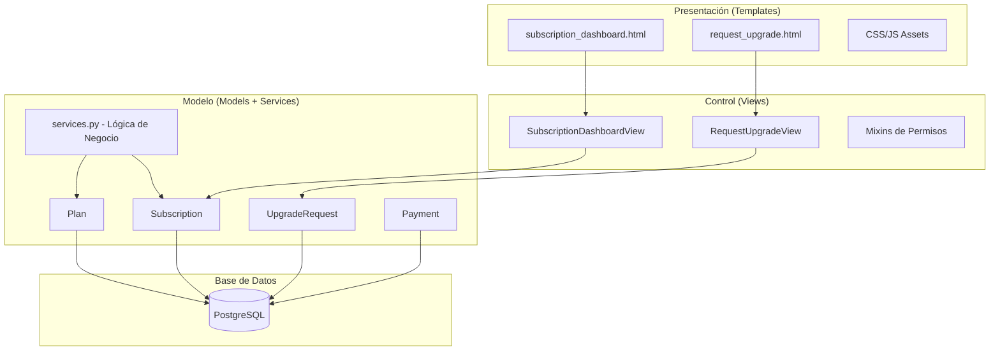

# 🔧 Implementación Técnica - Módulo de Planes

## 📋 Tabla de Contenidos

1. [Arquitectura del Sistema](#arquitectura-del-sistema)
2. [Modelos de Datos Detallados](#modelos-de-datos-detallados)
3. [Lógica de Negocio](#lógica-de-negocio)
4. [Vistas y Controllers](#vistas-y-controllers)
5. [Template Tags Personalizados](#template-tags-personalizados)
6. [Sistema de Permisos](#sistema-de-permisos)
7. [Comandos de Gestión](#comandos-de-gestión)
8. [Frontend y JavaScript](#frontend-y-javascript)
9. [Testing y Validación](#testing-y-validación)
10. [Optimización y Performance](#optimización-y-performance)

---

## 🏗️ Arquitectura del Sistema

### **Patrón MVC Implementado**



### **Principios de Diseño**

1. **Separación de Responsabilidades**
   - Models: Lógica de datos y reglas de negocio
   - Views: Lógica de presentación y control de flujo
   - Templates: Presentación visual y UX
   - Services: Lógica de negocio compleja

2. **DRY (Don't Repeat Yourself)**
   - Template tags reutilizables
   - Mixins para permisos comunes
   - CSS con variables del sistema base

3. **Principio de Responsabilidad Única**
   - Cada modelo tiene una responsabilidad específica
   - Vistas enfocadas en una funcionalidad
   - Comandos de gestión especializados

---

## 🗃️ Modelos de Datos Detallados

### **1. Plan Model**

```python
class Plan(models.Model):
    """
    Modelo que define los planes de suscripción disponibles.
    
    Características:
    - Soporte para diferentes tipos de plan (trial, basic, premium)
    - Configuración flexible de precios y límites
    - Gestión de períodos de prueba y gracia
    - Sistema de activación/desactivación
    """
    
    PLAN_TYPES = [
        ('trial', 'Prueba Gratuita'),
        ('basic', 'Plan Básico'),
        ('premium', 'Plan Premium'),        # Para futuras versiones
        ('enterprise', 'Plan Empresarial'), # Para futuras versiones
    ]
    
    # Campos principales
    name = models.CharField(
        "Nombre del plan", 
        max_length=50, 
        choices=PLAN_TYPES, 
        unique=True,
        db_index=True  # Optimización para búsquedas
    )
    display_name = models.CharField("Nombre para mostrar", max_length=100)
    description = models.TextField("Descripción", blank=True)
    
    # Configuración económica
    price = models.DecimalField(
        "Precio", 
        max_digits=10, 
        decimal_places=2, 
        default=0,
        help_text="Precio mensual en USD"
    )
    
    # Límites y características
    max_users = models.PositiveIntegerField(
        "Máximo de usuarios", 
        default=1,
        help_text="Número máximo de usuarios permitidos"
    )
    
    # Configuración temporal
    trial_days = models.PositiveIntegerField(
        "Días de prueba", 
        default=0, 
        help_text="Para planes 'trial', establece la duración"
    )
    billing_cycle_days = models.PositiveIntegerField(
        "Días del ciclo de facturación", 
        default=30
    )
    grace_period_days = models.PositiveIntegerField(
        "Días de gracia", 
        default=0,
        help_text="Días adicionales después de expiración"
    )
    
    # Estado y metadatos
    is_active = models.BooleanField("Activo", default=True, db_index=True)
    created_at = models.DateTimeField("Fecha de creación", auto_now_add=True)
    updated_at = models.DateTimeField("Última actualización", auto_now=True)
    
    class Meta:
        verbose_name = "Plan"
        verbose_name_plural = "Planes"
        ordering = ['price', 'name']
        indexes = [
            models.Index(fields=['is_active', 'price']),
            models.Index(fields=['name']),
        ]
    
    def __str__(self):
        return f"{self.display_name} (${self.price}/mes)"
    
    @classmethod
    def get_trial_plan(cls):
        """Obtiene el plan de prueba activo"""
        return cls.objects.filter(name='trial', is_active=True).first()
    
    @classmethod
    def get_available_plans(cls):
        """Obtiene todos los planes activos ordenados por precio"""
        return cls.objects.filter(is_active=True).order_by('price')
    
    def get_feature_list(self):
        """Retorna las características del plan como una lista"""
        features = [
            f"Hasta {self.max_users} usuario{'s' if self.max_users != 1 else ''}"
        ]
        
        if self.name == 'trial':
            features.extend([
                f"Prueba gratuita de {self.trial_days} días",
                "Funcionalidades básicas",
                "Soporte por email"
            ])
        elif self.name == 'basic':
            features.extend([
                "Proyectos ilimitados",
                "Almacenamiento estándar",
                "Soporte prioritario"
            ])
        
        return features
    
    def can_upgrade_to(self, target_plan):
        """Verifica si se puede actualizar a otro plan"""
        return target_plan.price > self.price and target_plan.is_active
```

### **2. Subscription Model**

```python
class Subscription(models.Model):
    """
    Modelo que representa la suscripción activa de una organización.
    
    Características:
    - Relación uno-a-uno con Organization
    - Gestión automática de estados
    - Cálculo de fechas y períodos
    - Historial de cambios
    """
    
    STATUS_CHOICES = [
        ('active', 'Activa'),
        ('trial', 'Prueba'),
        ('expired', 'Expirada'),
        ('cancelled', 'Cancelada'),
        ('grace_period', 'Período de Gracia'),
    ]
    
    # Relaciones
    organization = models.OneToOneField(
        'orgs.Organization', 
        on_delete=models.CASCADE,
        related_name='subscription'
    )
    plan = models.ForeignKey(
        Plan, 
        on_delete=models.PROTECT,  # Protege contra eliminación accidental
        related_name='subscriptions'
    )
    
    # Fechas y estado
    start_date = models.DateTimeField("Fecha de inicio", auto_now_add=True)
    end_date = models.DateTimeField(
        "Fecha de fin", 
        null=True, 
        blank=True,
        help_text="Null para suscripciones sin límite"
    )
    is_active = models.BooleanField("Activa", default=True, db_index=True)
    status = models.CharField(
        "Estado", 
        max_length=20, 
        choices=STATUS_CHOICES, 
        default='active',
        db_index=True
    )
    
    # Metadatos
    created_at = models.DateTimeField("Fecha de creación", auto_now_add=True)
    updated_at = models.DateTimeField("Última actualización", auto_now=True)
    
    class Meta:
        verbose_name = "Suscripción"
        verbose_name_plural = "Suscripciones"
        indexes = [
            models.Index(fields=['status', 'end_date']),
            models.Index(fields=['is_active', 'plan']),
        ]
    
    def __str__(self):
        return f"{self.organization.name} - {self.plan.display_name}"
    
    @property
    def is_trial(self):
        """Verifica si es una suscripción de prueba"""
        return self.plan.name == 'trial'
    
    @property
    def is_expired(self):
        """Verifica si la suscripción ha expirado"""
        if not self.end_date:
            return False
        return timezone.now() > self.end_date
    
    @property
    def is_in_grace_period(self):
        """Verifica si está en período de gracia"""
        if not self.is_expired or not self.plan.grace_period_days:
            return False
        
        grace_end = self.end_date + timedelta(days=self.plan.grace_period_days)
        return timezone.now() <= grace_end
    
    @property
    def days_remaining(self):
        """Calcula los días restantes hasta la expiración"""
        if not self.end_date:
            return None
        
        now = timezone.now()
        if self.is_in_grace_period:
            # Durante período de gracia, mostrar días negativos restantes
            grace_end = self.end_date + timedelta(days=self.plan.grace_period_days)
            delta = grace_end - now
        else:
            delta = self.end_date - now
        
        return max(0, delta.days)
    
    def update_status(self):
        """Actualiza el estado de la suscripción basado en fechas"""
        if self.is_expired:
            if self.is_in_grace_period:
                self.status = 'grace_period'
            else:
                self.status = 'expired'
                self.is_active = False
        elif self.is_trial:
            self.status = 'trial'
        else:
            self.status = 'active'
        
        self.save(update_fields=['status', 'is_active', 'updated_at'])
        
        logger.info(f"Estado de suscripción actualizado: {self.organization.name} -> {self.status}")
    
    def extend_subscription(self, days):
        """Extiende la suscripción por X días"""
        if self.end_date:
            self.end_date += timedelta(days=days)
        else:
            # Si no tenía fecha de fin, establecer una
            self.end_date = timezone.now() + timedelta(days=days)
        
        self.save(update_fields=['end_date', 'updated_at'])
        logger.info(f"Suscripción extendida {days} días: {self.organization.name}")
    
    def change_plan(self, new_plan, extend_days=None):
        """Cambia el plan de la suscripción"""
        old_plan = self.plan
        self.plan = new_plan
        
        if extend_days:
            self.extend_subscription(extend_days)
        
        self.update_status()
        
        # Crear registro de pago/cambio
        Payment.objects.create(
            subscription=self,
            amount=new_plan.price,
            payment_method='upgrade',
            payment_type='upgrade',
            status='completed',
            description=f'Actualización de plan: {old_plan.display_name} -> {new_plan.display_name}'
        )
        
        logger.info(f"Plan actualizado: {self.organization.name} de {old_plan.display_name} a {new_plan.display_name}")
    
    def get_payment_history(self, limit=10):
        """Obtiene el historial de pagos"""
        return self.payments.order_by('-created_at')[:limit]
```

### **3. UpgradeRequest Model**

```python
class UpgradeRequest(models.Model):
    """
    Modelo para gestionar solicitudes de actualización de plan.
    
    Flujo:
    1. Usuario solicita actualización (status='pending')
    2. Admin revisa y aprueba/rechaza
    3. Si se aprueba, se coordina el pago
    4. Una vez pagado, se actualiza la suscripción
    """
    
    STATUS_CHOICES = [
        ('pending', 'Pendiente'),
        ('approved', 'Aprobada'),
        ('rejected', 'Rechazada'),
        ('completed', 'Completada'),
        ('cancelled', 'Cancelada'),
    ]
    
    # Relaciones
    organization = models.ForeignKey(
        'orgs.Organization', 
        on_delete=models.CASCADE,
        related_name='upgrade_requests'
    )
    current_plan = models.ForeignKey(
        Plan, 
        on_delete=models.PROTECT,
        related_name='upgrade_from'
    )
    requested_plan = models.ForeignKey(
        Plan, 
        on_delete=models.PROTECT,
        related_name='upgrade_to'
    )
    
    # Información de la solicitud
    amount = models.DecimalField(
        "Monto del upgrade", 
        max_digits=10, 
        decimal_places=2,
        help_text="Diferencia de precio o monto total"
    )
    status = models.CharField(
        "Estado", 
        max_length=20, 
        choices=STATUS_CHOICES, 
        default='pending',
        db_index=True
    )
    
    # Notas y comentarios
    user_notes = models.TextField("Notas del usuario", blank=True)
    admin_notes = models.TextField("Notas administrativas", blank=True)
    rejection_reason = models.TextField("Motivo de rechazo", blank=True)
    
    # Metadatos
    created_at = models.DateTimeField("Fecha de solicitud", auto_now_add=True)
    updated_at = models.DateTimeField("Última actualización", auto_now=True)
    processed_at = models.DateTimeField("Fecha de procesamiento", null=True, blank=True)
    
    class Meta:
        verbose_name = "Solicitud de Actualización"
        verbose_name_plural = "Solicitudes de Actualización"
        ordering = ['-created_at']
        indexes = [
            models.Index(fields=['status', 'created_at']),
            models.Index(fields=['organization', 'status']),
        ]
    
    def __str__(self):
        return f"{self.organization.name}: {self.current_plan.display_name} -> {self.requested_plan.display_name}"
    
    def approve(self, admin_notes=""):
        """Aprueba la solicitud de actualización"""
        self.status = 'approved'
        self.admin_notes = admin_notes
        self.processed_at = timezone.now()
        self.save()
        
        logger.info(f"Solicitud de actualización aprobada: {self}")
        
        # Aquí se podría enviar notificación al usuario
        # send_upgrade_approved_notification(self)
    
    def reject(self, reason=""):
        """Rechaza la solicitud de actualización"""
        self.status = 'rejected'
        self.rejection_reason = reason
        self.processed_at = timezone.now()
        self.save()
        
        logger.info(f"Solicitud de actualización rechazada: {self} - Motivo: {reason}")
        
        # Notificar al usuario del rechazo
        # send_upgrade_rejected_notification(self)
    
    def complete(self):
        """Marca la solicitud como completada y actualiza la suscripción"""
        try:
            with transaction.atomic():
                # Actualizar la suscripción
                subscription = self.organization.subscription
                subscription.change_plan(
                    new_plan=self.requested_plan,
                    extend_days=self.requested_plan.billing_cycle_days
                )
                
                # Marcar solicitud como completada
                self.status = 'completed'
                self.processed_at = timezone.now()
                self.save()
                
                logger.info(f"Actualización a {self.requested_plan.display_name} completada para {self.organization.name}")
                
        except Exception as e:
            logger.error(f"Error al completar solicitud de actualización {self.id}: {str(e)}", exc_info=True)
            raise
    
    def can_be_processed(self):
        """Verifica si la solicitud puede ser procesada"""
        return self.status == 'pending'
    
    @classmethod
    def get_pending_requests(cls):
        """Obtiene todas las solicitudes pendientes"""
        return cls.objects.filter(status='pending').order_by('created_at')
```

---

## 🎯 Lógica de Negocio

### **services.py - Servicios del Sistema**

```python
# apps/plans/services.py
import logging
from datetime import timedelta
from django.utils import timezone
from django.db import transaction
from .models import Plan, Subscription, UpgradeRequest

logger = logging.getLogger(__name__)

class SubscriptionService:
    """Servicio para gestionar operaciones de suscripción"""
    
    @staticmethod
    def create_trial_subscription(organization):
        """Crea una suscripción de prueba para una nueva organización"""
        trial_plan = Plan.get_trial_plan()
        if not trial_plan:
            raise ValueError("No hay plan de prueba disponible")
        
        end_date = timezone.now() + timedelta(days=trial_plan.trial_days)
        
        subscription = Subscription.objects.create(
            organization=organization,
            plan=trial_plan,
            end_date=end_date,
            status='trial'
        )
        
        logger.info(f"Suscripción de prueba creada para {organization.name}")
        return subscription
    
    @staticmethod
    def update_expired_subscriptions():
        """Actualiza todas las suscripciones expiradas"""
        expired_subscriptions = Subscription.objects.filter(
            end_date__lt=timezone.now(),
            is_active=True
        )
        
        updated_count = 0
        for subscription in expired_subscriptions:
            subscription.update_status()
            updated_count += 1
        
        logger.info(f"Actualizadas {updated_count} suscripciones expiradas")
        return updated_count
    
    @staticmethod
    def get_subscription_stats():
        """Obtiene estadísticas de suscripciones"""
        from django.db.models import Count
        
        stats = Subscription.objects.values('status').annotate(
            count=Count('id')
        ).order_by('status')
        
        return {stat['status']: stat['count'] for stat in stats}

class UpgradeService:
    """Servicio para gestionar actualizaciones de plan"""
    
    @staticmethod
    def request_upgrade(organization, requested_plan, user_notes=""):
        """Crea una solicitud de actualización"""
        subscription = organization.subscription
        
        # Validaciones
        if not requested_plan.can_upgrade_to(subscription.plan):
            raise ValueError("No se puede actualizar a ese plan")
        
        if UpgradeRequest.objects.filter(
            organization=organization, 
            status='pending'
        ).exists():
            raise ValueError("Ya existe una solicitud pendiente")
        
        # Crear solicitud
        upgrade_request = UpgradeRequest.objects.create(
            organization=organization,
            current_plan=subscription.plan,
            requested_plan=requested_plan,
            amount=requested_plan.price,
            user_notes=user_notes
        )
        
        logger.info(f"Solicitud de actualización creada: {upgrade_request}")
        return upgrade_request
    
    @staticmethod
    def process_pending_requests():
        """Procesa solicitudes pendientes (para uso administrativo)"""
        pending_requests = UpgradeRequest.get_pending_requests()
        
        processed = 0
        for request in pending_requests:
            # Aquí iría la lógica de procesamiento automático
            # Por ahora, solo las marcamos para revisión manual
            logger.info(f"Solicitud pendiente de revisión: {request}")
            processed += 1
        
        return processed
    
    @staticmethod
    def clean_old_requests(days=90):
        """Limpia solicitudes antiguas completadas/rechazadas"""
        cutoff_date = timezone.now() - timedelta(days=days)
        
        old_requests = UpgradeRequest.objects.filter(
            status__in=['completed', 'rejected'],
            created_at__lt=cutoff_date
        )
        
        count = old_requests.count()
        old_requests.delete()
        
        logger.info(f"Eliminadas {count} solicitudes antiguas")
        return count
```

---

## 🎮 Vistas y Controllers

### **SubscriptionDashboardView**

```python
class SubscriptionDashboardView(LoginRequiredMixin, TemplateView):
    """
    Dashboard principal de suscripción.
    
    Funcionalidades:
    - Muestra estado actual de la suscripción
    - Motivador para usuarios de plan gratuito
    - Indicadores de solicitudes pendientes
    - Información de uso y recursos
    """
    template_name = 'plans/subscription_dashboard.html'
    
    def get_context_data(self, **kwargs):
        context = super().get_context_data(**kwargs)
        user = self.request.user
        organization = getattr(user, 'organization', None)
        
        if not organization:
            context['no_organization'] = True
            return context
        
        # Obtener o crear suscripción
        subscription = Subscription.objects.filter(organization=organization).first()
        if not subscription:
            subscription = SubscriptionService.create_trial_subscription(organization)
        
        # Actualizar estado automáticamente
        subscription.update_status()
        
        # Contexto principal
        context.update({
            'subscription': subscription,
            'organization': organization,
            'is_org_admin': user.is_org_admin,
        })
        
        # Solicitud pendiente
        context['pending_request'] = UpgradeRequest.objects.filter(
            organization=organization,
            status='pending'
        ).first()
        
        # Planes disponibles para actualización
        if not context['pending_request']:
            context['available_plans'] = Plan.objects.filter(
                is_active=True,
                price__gt=subscription.plan.price
            ).order_by('price')
        
        return context
```

### **RequestUpgradeView**

```python
class RequestUpgradeView(LoginRequiredMixin, OrgAdminRequiredMixin, TemplateView):
    """
    Vista para solicitar actualización de plan.
    
    Características:
    - Solo accesible para administradores de organización
    - Muestra comparación de planes
    - Maneja solicitudes pendientes
    - Procesa formularios de actualización
    """
    template_name = 'plans/request_upgrade.html'
    
    def get_context_data(self, **kwargs):
        context = super().get_context_data(**kwargs)
        organization = self.request.user.organization
        subscription = get_object_or_404(Subscription, organization=organization)
        
        context['subscription'] = subscription
        
        # Verificar solicitud pendiente
        pending_request = UpgradeRequest.objects.filter(
            organization=organization,
            status='pending'
        ).first()
        
        context['has_pending_request'] = bool(pending_request)
        context['pending_request'] = pending_request
        
        # Planes disponibles solo si no hay solicitud pendiente
        if not pending_request:
            context['available_plans'] = Plan.objects.filter(
                is_active=True,
                price__gt=subscription.plan.price
            ).order_by('price')
        
        return context
    
    def post(self, request, *args, **kwargs):
        """Procesa solicitud de actualización"""
        organization = request.user.organization
        subscription = get_object_or_404(Subscription, organization=organization)
        requested_plan_id = request.POST.get('requested_plan')
        
        try:
            # Validaciones
            if UpgradeRequest.objects.filter(
                organization=organization, 
                status='pending'
            ).exists():
                messages.warning(request, "Ya tienes una solicitud de actualización pendiente.")
                return redirect('plans:subscription_dashboard')
            
            if not requested_plan_id:
                messages.error(request, "Debes seleccionar un plan.")
                return redirect('plans:request_upgrade')
            
            # Obtener y validar plan
            try:
                requested_plan = Plan.objects.get(id=requested_plan_id, is_active=True)
            except Plan.DoesNotExist:
                messages.error(request, "El plan seleccionado no es válido.")
                return redirect('plans:request_upgrade')
            
            # Validar que sea actualización
            if requested_plan.price <= subscription.plan.price:
                messages.error(request, "Solo puedes actualizar a un plan de mayor valor.")
                return redirect('plans:request_upgrade')
            
            # Crear solicitud usando el servicio
            user_notes = request.POST.get('notes', '')
            upgrade_request = UpgradeService.request_upgrade(
                organization=organization,
                requested_plan=requested_plan,
                user_notes=user_notes
            )
            
            messages.success(
                request,
                f"Tu solicitud de actualización a {requested_plan.display_name} ha sido enviada. "
                "Recibirás instrucciones de pago una vez que sea aprobada."
            )
            return redirect('plans:subscription_dashboard')
            
        except ValueError as e:
            messages.error(request, str(e))
            return redirect('plans:request_upgrade')
        except Exception as e:
            logger.error(f"Error al crear solicitud de actualización: {e}", exc_info=True)
            messages.error(request, "Ocurrió un error al procesar tu solicitud. Por favor, contacta a soporte.")
            return redirect('plans:request_upgrade')
```

---

## 🏷️ Template Tags Personalizados

### **plan_extras.py**

```python
from django import template
from decimal import Decimal
import locale

register = template.Library()

@register.filter
def format_currency(value):
    """
    Formatea un valor como moneda.
    
    Uso: {{ plan.price|format_currency }}
    Resultado: $29.99
    """
    if value is None:
        return "$0.00"
    
    try:
        # Convertir a Decimal para precisión
        if isinstance(value, str):
            value = Decimal(value)
        
        # Formatear como moneda
        return f"${value:,.2f}"
    except (ValueError, TypeError):
        return "$0.00"

@register.filter
def percentage(value, total):
    """
    Calcula el porcentaje de uso.
    
    Uso: {{ current_users|percentage:max_users }}
    Resultado: 75 (para usar en width: 75%)
    """
    if not total or total == 0:
        return 0
    
    try:
        value = float(value) if value else 0
        total = float(total)
        result = (value / total) * 100
        return min(100, round(result))
    except (ValueError, TypeError, ZeroDivisionError):
        return 0

@register.filter
def subtract(value, arg):
    """
    Resta dos valores.
    
    Uso: {{ max_users|subtract:current_users }}
    Resultado: 3 (si max_users=5 y current_users=2)
    """
    try:
        return int(value) - int(arg)
    except (ValueError, TypeError):
        return 0

@register.filter
def pluralize_es(value, singular_plural=""):
    """
    Pluralización en español.
    
    Uso: {{ days|pluralize_es:"día,días" }}
    """
    try:
        count = int(value)
    except (ValueError, TypeError):
        count = 0
    
    if not singular_plural:
        return "s" if count != 1 else ""
    
    try:
        singular, plural = singular_plural.split(',')
        return plural if count != 1 else singular
    except ValueError:
        return singular_plural if count != 1 else ""

@register.filter
def usage_status_class(percentage):
    """
    Retorna la clase CSS según el porcentaje de uso.
    
    Uso: {{ percentage|usage_status_class }}
    """
    try:
        pct = float(percentage)
        if pct >= 90:
            return "warning"
        elif pct >= 75:
            return "caution"
        else:
            return "good"
    except (ValueError, TypeError):
        return "good"

@register.simple_tag
def get_plan_feature_count(plan):
    """
    Obtiene el número de características del plan.
    
    Uso: 
    """
    return len(plan.get_feature_list())

@register.inclusion_tag('plans/partials/plan_badge.html')
def plan_badge(subscription):
    """
    Renderiza un badge del estado del plan.
    
    Uso: 
    """
    return {
        'subscription': subscription,
        'badge_class': _get_badge_class(subscription),
        'badge_text': _get_badge_text(subscription),
    }

def _get_badge_class(subscription):
    """Determina la clase CSS del badge"""
    if subscription.is_expired:
        return "badge-danger"
    elif subscription.is_in_grace_period:
        return "badge-warning"
    elif subscription.is_trial:
        return "badge-info"
    else:
        return "badge-success"

def _get_badge_text(subscription):
    """Determina el texto del badge"""
    if subscription.is_expired:
        return "Expirado"
    elif subscription.is_in_grace_period:
        return "Período de Gracia"
    elif subscription.is_trial:
        return "Prueba Gratuita"
    else:
        return "Activo"

@register.filter
def days_until_expiry(subscription):
    """
    Calcula días hasta expiración con formato legible.
    
    Uso: {{ subscription|days_until_expiry }}
    """
    days = subscription.days_remaining
    if days is None:
        return "Sin límite"
    elif days == 0:
        return "Expira hoy"
    elif days == 1:
        return "Expira mañana"
    else:
        return f"Expira en {days} días"
```

---

## 🔐 Sistema de Permisos

### **Mixins de Permisos**

```python
# apps/plans/mixins.py
from django.contrib.auth.mixins import UserPassesTestMixin
from django.core.exceptions import PermissionDenied
from django.shortcuts import redirect
from django.contrib import messages

class OrgAdminRequiredMixin(UserPassesTestMixin):
    """
    Mixin que requiere que el usuario sea administrador de organización.
    """
    
    def test_func(self):
        return (
            self.request.user.is_authenticated and 
            hasattr(self.request.user, 'organization') and
            self.request.user.is_org_admin
        )
    
    def handle_no_permission(self):
        if not self.request.user.is_authenticated:
            return super().handle_no_permission()
        
        messages.error(
            self.request, 
            "Necesitas permisos de administrador de organización para acceder a esta página."
        )
        return redirect('plans:subscription_dashboard')

class ActiveSubscriptionRequiredMixin(UserPassesTestMixin):
    """
    Mixin que requiere una suscripción activa.
    """
    
    def test_func(self):
        user = self.request.user
        if not user.is_authenticated or not hasattr(user, 'organization'):
            return False
        
        subscription = getattr(user.organization, 'subscription', None)
        return subscription and subscription.is_active

    def handle_no_permission(self):
        messages.warning(
            self.request,
            "Tu suscripción no está activa. Por favor, contacta a soporte."
        )
        return redirect('plans:subscription_dashboard')

class PlanLimitMixin:
    """
    Mixin para verificar límites del plan.
    """
    
    def check_user_limit(self):
        """Verifica si se puede agregar más usuarios"""
        organization = self.request.user.organization
        subscription = organization.subscription
        current_users = organization.users.count()
        
        if current_users >= subscription.plan.max_users:
            messages.warning(
                self.request,
                f"Has alcanzado el límite de {subscription.plan.max_users} usuarios para tu plan actual. "
                f"Considera actualizar tu plan para agregar más usuarios."
            )
            return False
        return True
    
    def check_project_limit(self):
        """Verifica si se pueden crear más proyectos"""
        # Por ahora, los proyectos son ilimitados excepto en trial
        organization = self.request.user.organization
        subscription = organization.subscription
        
        if subscription.is_trial:
            current_projects = organization.projects.count()
            if current_projects >= 3:  # Límite arbitrario para trial
                messages.warning(
                    self.request,
                    "Has alcanzado el límite de proyectos para tu plan de prueba. "
                    "Actualiza tu plan para crear proyectos ilimitados."
                )
                return False
        return True
```

### **Decoradores de Permisos**

```python
# apps/plans/decorators.py
from functools import wraps
from django.shortcuts import redirect
from django.contrib import messages
from django.core.exceptions import PermissionDenied

def org_admin_required(view_func):
    """
    Decorador que requiere permisos de administrador de organización.
    """
    @wraps(view_func)
    def wrapper(request, *args, **kwargs):
        if not request.user.is_authenticated:
            return redirect('accounts:login')
        
        if not hasattr(request.user, 'organization') or not request.user.is_org_admin:
            messages.error(request, "Necesitas permisos de administrador.")
            return redirect('plans:subscription_dashboard')
        
        return view_func(request, *args, **kwargs)
    return wrapper

def active_subscription_required(view_func):
    """
    Decorador que requiere suscripción activa.
    """
    @wraps(view_func)
    def wrapper(request, *args, **kwargs):
        user = request.user
        if not user.is_authenticated or not hasattr(user, 'organization'):
            return redirect('accounts:login')
        
        subscription = getattr(user.organization, 'subscription', None)
        if not subscription or not subscription.is_active:
            messages.warning(request, "Tu suscripción no está activa.")
            return redirect('plans:subscription_dashboard')
        
        return view_func(request, *args, **kwargs)
    return wrapper

def plan_limit_check(limit_type):
    """
    Decorador para verificar límites del plan.
    
    Uso: @plan_limit_check('users') o @plan_limit_check('projects')
    """
    def decorator(view_func):
        @wraps(view_func)
        def wrapper(request, *args, **kwargs):
            organization = request.user.organization
            subscription = organization.subscription
            
            if limit_type == 'users':
                current = organization.users.count()
                limit = subscription.plan.max_users
                limit_name = "usuarios"
            elif limit_type == 'projects':
                if subscription.is_trial:
                    current = organization.projects.count()
                    limit = 3  # Límite para trial
                    limit_name = "proyectos"
                else:
                    # Sin límite para planes de pago
                    return view_func(request, *args, **kwargs)
            else:
                return view_func(request, *args, **kwargs)
            
            if current >= limit:
                messages.warning(
                    request,
                    f"Has alcanzado el límite de {limit} {limit_name} para tu plan actual."
                )
                return redirect('plans:subscription_dashboard')
            
            return view_func(request, *args, **kwargs)
        return wrapper
    return decorator
```

---

## ⚙️ Comandos de Gestión

### **update_expired_subscriptions.py**

```python
from django.core.management.base import BaseCommand
from django.utils import timezone
from apps.plans.services import SubscriptionService
import logging

logger = logging.getLogger(__name__)

class Command(BaseCommand):
    help = 'Actualiza el estado de suscripciones expiradas'
    
    def add_arguments(self, parser):
        parser.add_argument(
            '--dry-run',
            action='store_true',
            help='Simula la ejecución sin hacer cambios',
        )
        parser.add_argument(
            '--verbose',
            action='store_true',
            help='Muestra información detallada',
        )
    
    def handle(self, *args, **options):
        dry_run = options['dry_run']
        verbose = options['verbose']
        
        if dry_run:
            self.stdout.write(
                self.style.WARNING('MODO SIMULACIÓN - No se harán cambios')
            )
        
        if verbose:
            self.stdout.write('Iniciando actualización de suscripciones...')
        
        try:
            updated_count = SubscriptionService.update_expired_subscriptions()
            
            if updated_count > 0:
                self.stdout.write(
                    self.style.SUCCESS(
                        f'Actualizadas {updated_count} suscripciones expiradas'
                    )
                )
            else:
                self.stdout.write('No hay suscripciones que actualizar')
                
        except Exception as e:
            logger.error(f"Error en update_expired_subscriptions: {e}", exc_info=True)
            self.stdout.write(
                self.style.ERROR(f'Error: {str(e)}')
            )
            raise
```

---

## 🌐 Frontend y JavaScript

### **plans.js - Funcionalidades del Dashboard**

```javascript
/**
 * JavaScript para el dashboard de suscripción
 * Maneja interacciones y efectos visuales
 */

class PlansManager {
    constructor() {
        this.init();
    }
    
    init() {
        this.setupProgressBars();
        this.setupTooltips();
        this.setupRefreshButton();
        this.setupScrollEffects();
    }
    
    setupProgressBars() {
        // Animar barras de progreso al cargar
        const progressBars = document.querySelectorAll('.progress-fill');
        
        progressBars.forEach(bar => {
            const width = bar.style.width;
            bar.style.width = '0%';
            
            setTimeout(() => {
                bar.style.transition = 'width 1s ease';
                bar.style.width = width;
            }, 100);
        });
    }
    
    setupTooltips() {
        // Configurar tooltips para elementos informativos
        const tooltipElements = document.querySelectorAll('[data-tooltip]');
        
        tooltipElements.forEach(element => {
            element.addEventListener('mouseenter', this.showTooltip);
            element.addEventListener('mouseleave', this.hideTooltip);
        });
    }
    
    setupRefreshButton() {
        const refreshBtn = document.querySelector('.refresh-status-btn');
        
        if (refreshBtn) {
            refreshBtn.addEventListener('click', (e) => {
                e.preventDefault();
                this.refreshSubscriptionStatus();
            });
        }
    }
    
    setupScrollEffects() {
        // Efectos de reveal al hacer scroll
        const observer = new IntersectionObserver((entries) => {
            entries.forEach(entry => {
                if (entry.isIntersecting) {
                    entry.target.classList.add('animate-in');
                }
            });
        });
        
        document.querySelectorAll('.info-card, .usage-card').forEach(card => {
            observer.observe(card);
        });
    }
    
    async refreshSubscriptionStatus() {
        const refreshBtn = document.querySelector('.refresh-status-btn');
        const originalText = refreshBtn.innerHTML;
        
        try {
            // Mostrar loading
            refreshBtn.innerHTML = '<i class="fas fa-spinner fa-spin"></i> Actualizando...';
            refreshBtn.disabled = true;
            
            // Simular actualización (en una implementación real, haría una llamada AJAX)
            await new Promise(resolve => setTimeout(resolve, 1000));
            
            // Recargar la página para mostrar datos actualizados
            window.location.reload();
            
        } catch (error) {
            console.error('Error al actualizar estado:', error);
            
            // Mostrar error
            refreshBtn.innerHTML = '<i class="fas fa-exclamation-triangle"></i> Error';
            refreshBtn.classList.add('btn-error');
            
            setTimeout(() => {
                refreshBtn.innerHTML = originalText;
                refreshBtn.disabled = false;
                refreshBtn.classList.remove('btn-error');
            }, 2000);
        }
    }
    
    showTooltip(event) {
        const element = event.target;
        const text = element.getAttribute('data-tooltip');
        
        const tooltip = document.createElement('div');
        tooltip.className = 'tooltip';
        tooltip.textContent = text;
        
        document.body.appendChild(tooltip);
        
        // Posicionar tooltip
        const rect = element.getBoundingClientRect();
        tooltip.style.left = rect.left + (rect.width / 2) - (tooltip.offsetWidth / 2) + 'px';
        tooltip.style.top = rect.top - tooltip.offsetHeight - 10 + 'px';
        
        element._tooltip = tooltip;
    }
    
    hideTooltip(event) {
        const element = event.target;
        if (element._tooltip) {
            document.body.removeChild(element._tooltip);
            delete element._tooltip;
        }
    }
}

// Utilitades adicionales
class SubscriptionUtils {
    static formatCurrency(amount) {
        return new Intl.NumberFormat('es-US', {
            style: 'currency',
            currency: 'USD'
        }).format(amount);
    }
    
    static formatDaysRemaining(days) {
        if (days === null) return 'Sin límite';
        if (days === 0) return 'Expira hoy';
        if (days === 1) return 'Expira mañana';
        return `${days} días restantes`;
    }
    
    static getStatusClass(status) {
        const statusMap = {
            'active': 'status-active',
            'trial': 'status-trial',
            'expired': 'status-expired',
            'grace_period': 'status-warning'
        };
        return statusMap[status] || 'status-unknown';
    }
}

// Inicializar cuando el DOM esté listo
document.addEventListener('DOMContentLoaded', () => {
    new PlansManager();
});

// Exportar para uso global
window.PlansManager = PlansManager;
window.SubscriptionUtils = SubscriptionUtils;
```

---

## 🧪 Testing y Validación

### **Casos de Prueba Principales**

```python
# tests/test_subscription_views.py
from django.test import TestCase, Client
from django.urls import reverse
from django.contrib.auth import get_user_model
from apps.plans.models import Plan, Subscription, UpgradeRequest
from apps.orgs.models import Organization

User = get_user_model()

class SubscriptionDashboardTests(TestCase):
    def setUp(self):
        self.client = Client()
        
        # Crear organización y usuario
        self.org = Organization.objects.create(name="Test Org")
        self.user = User.objects.create_user(
            username="testuser",
            email="test@example.com",
            password="testpass123",
            organization=self.org,
            is_org_admin=True
        )
        
        # Crear planes
        self.trial_plan = Plan.objects.create(
            name='trial',
            display_name='Prueba Gratuita',
            price=0,
            max_users=3,
            trial_days=30
        )
        
        self.basic_plan = Plan.objects.create(
            name='basic',
            display_name='Plan Básico',
            price=29.99,
            max_users=10
        )
        
        # Crear suscripción
        self.subscription = Subscription.objects.create(
            organization=self.org,
            plan=self.trial_plan,
            status='trial'
        )
    
    def test_dashboard_access_requires_login(self):
        """El dashboard requiere autenticación"""
        response = self.client.get(reverse('plans:subscription_dashboard'))
        self.assertRedirects(response, '/accounts/login/?next=/plans/dashboard/')
    
    def test_dashboard_shows_trial_motivator(self):
        """Muestra el motivador para usuarios de prueba"""
        self.client.login(username='testuser', password='testpass123')
        response = self.client.get(reverse('plans:subscription_dashboard'))
        
        self.assertEqual(response.status_code, 200)
        self.assertContains(response, 'upgrade-motivator-card')
        self.assertContains(response, 'Potencia tu organización')
    
    def test_dashboard_shows_pending_request(self):
        """Muestra solicitudes pendientes correctamente"""
        # Crear solicitud pendiente
        UpgradeRequest.objects.create(
            organization=self.org,
            current_plan=self.trial_plan,
            requested_plan=self.basic_plan,
            amount=self.basic_plan.price
        )
        
        self.client.login(username='testuser', password='testpass123')
        response = self.client.get(reverse('plans:subscription_dashboard'))
        
        self.assertContains(response, 'request-status-card')
        self.assertContains(response, 'está en proceso')

class RequestUpgradeTests(TestCase):
    def setUp(self):
        # Similar setup...
        pass
    
    def test_upgrade_requires_org_admin(self):
        """Solo org_admin puede solicitar actualizaciones"""
        # Cambiar usuario a no-admin
        self.user.is_org_admin = False
        self.user.save()
        
        self.client.login(username='testuser', password='testpass123')
        response = self.client.get(reverse('plans:request_upgrade'))
        
        self.assertRedirects(response, reverse('plans:subscription_dashboard'))
    
    def test_prevent_duplicate_requests(self):
        """Previene solicitudes duplicadas"""
        # Crear solicitud existente
        UpgradeRequest.objects.create(
            organization=self.org,
            current_plan=self.trial_plan,
            requested_plan=self.basic_plan,
            amount=self.basic_plan.price
        )
        
        self.client.login(username='testuser', password='testpass123')
        response = self.client.post(reverse('plans:request_upgrade'), {
            'requested_plan': self.basic_plan.id
        })
        
        # Debe redirigir con mensaje de error
        self.assertRedirects(response, reverse('plans:subscription_dashboard'))
    
    def test_successful_upgrade_request(self):
        """Solicitud exitosa de actualización"""
        self.client.login(username='testuser', password='testpass123')
        response = self.client.post(reverse('plans:request_upgrade'), {
            'requested_plan': self.basic_plan.id
        })
        
        # Verificar que se creó la solicitud
        self.assertTrue(
            UpgradeRequest.objects.filter(
                organization=self.org,
                requested_plan=self.basic_plan
            ).exists()
        )
        
        self.assertRedirects(response, reverse('plans:subscription_dashboard'))
```

### **Tests de Modelos**

```python
# tests/test_models.py
from django.test import TestCase
from django.utils import timezone
from datetime import timedelta
from apps.plans.models import Plan, Subscription, UpgradeRequest
from apps.orgs.models import Organization

class SubscriptionModelTests(TestCase):
    def setUp(self):
        self.org = Organization.objects.create(name="Test Org")
        self.trial_plan = Plan.objects.create(
            name='trial',
            display_name='Prueba Gratuita',
            price=0,
            trial_days=30,
            grace_period_days=7
        )
    
    def test_is_trial_property(self):
        """Verifica la propiedad is_trial"""
        subscription = Subscription.objects.create(
            organization=self.org,
            plan=self.trial_plan
        )
        self.assertTrue(subscription.is_trial)
    
    def test_is_expired_property(self):
        """Verifica la detección de expiración"""
        # Suscripción expirada
        expired_subscription = Subscription.objects.create(
            organization=self.org,
            plan=self.trial_plan,
            end_date=timezone.now() - timedelta(days=1)
        )
        self.assertTrue(expired_subscription.is_expired)
        
        # Suscripción vigente
        active_subscription = Subscription.objects.create(
            organization=self.org,
            plan=self.trial_plan,
            end_date=timezone.now() + timedelta(days=1)
        )
        self.assertFalse(active_subscription.is_expired)
    
    def test_grace_period_calculation(self):
        """Verifica el cálculo del período de gracia"""
        # Suscripción en período de gracia
        grace_subscription = Subscription.objects.create(
            organization=self.org,
            plan=self.trial_plan,
            end_date=timezone.now() - timedelta(days=3)  # Expirada hace 3 días
        )
        self.assertTrue(grace_subscription.is_in_grace_period)
        
        # Suscripción fuera del período de gracia
        expired_subscription = Subscription.objects.create(
            organization=self.org,
            plan=self.trial_plan,
            end_date=timezone.now() - timedelta(days=10)  # Expirada hace 10 días
        )
        self.assertFalse(expired_subscription.is_in_grace_period)
    
    def test_days_remaining_calculation(self):
        """Verifica el cálculo de días restantes"""
        subscription = Subscription.objects.create(
            organization=self.org,
            plan=self.trial_plan,
            end_date=timezone.now() + timedelta(days=5)
        )
        self.assertEqual(subscription.days_remaining, 5)
    
    def test_update_status_method(self):
        """Verifica la actualización automática de estado"""
        # Suscripción expirada
        subscription = Subscription.objects.create(
            organization=self.org,
            plan=self.trial_plan,
            end_date=timezone.now() - timedelta(days=10)
        )
        
        subscription.update_status()
        self.assertEqual(subscription.status, 'expired')
        self.assertFalse(subscription.is_active)
```

---

## ⚡ Optimización y Performance

### **Consultas Optimizadas**

```python
# Optimizaciones en views.py

class SubscriptionDashboardView(LoginRequiredMixin, TemplateView):
    def get_context_data(self, **kwargs):
        context = super().get_context_data(**kwargs)
        user = self.request.user
        
        # Optimización: select_related para evitar queries adicionales
        organization = getattr(user, 'organization', None)
        if not organization:
            context['no_organization'] = True
            return context
        
        # Una sola query con select_related
        subscription = Subscription.objects.select_related('plan').filter(
            organization=organization
        ).first()
        
        if not subscription:
            subscription = SubscriptionService.create_trial_subscription(organization)
        
        # Prefetch related para optimizar queries de relaciones
        pending_request = UpgradeRequest.objects.select_related(
            'requested_plan'
        ).filter(
            organization=organization,
            status='pending'
        ).first()
        
        # Query optimizada para planes disponibles
        available_plans = Plan.objects.filter(
            is_active=True,
            price__gt=subscription.plan.price
        ).only('id', 'display_name', 'price').order_by('price')
        
        context.update({
            'subscription': subscription,
            'organization': organization,
            'is_org_admin': user.is_org_admin,
            'pending_request': pending_request,
            'available_plans': available_plans,
        })
        
        return context
```

### **Índices de Base de Datos**

```python
# En models.py - Índices optimizados

class Subscription(models.Model):
    # ... campos ...
    
    class Meta:
        indexes = [
            # Índice compuesto para consultas frecuentes
            models.Index(fields=['status', 'end_date']),
            models.Index(fields=['is_active', 'plan']),
            # Índice para organización (FK automático)
            models.Index(fields=['organization']),
        ]

class UpgradeRequest(models.Model):
    # ... campos ...
    
    class Meta:
        indexes = [
            # Índice para búsquedas administrativas
            models.Index(fields=['status', 'created_at']),
            # Índice para consultas por organización
            models.Index(fields=['organization', 'status']),
        ]
```

### **Cache de Datos Frecuentes**

```python
# services.py - Implementación de cache

from django.core.cache import cache
from django.conf import settings

class SubscriptionService:
    @staticmethod
    def get_subscription_stats():
        """Obtiene estadísticas con cache"""
        cache_key = 'subscription_stats'
        stats = cache.get(cache_key)
        
        if stats is None:
            from django.db.models import Count
            stats = Subscription.objects.values('status').annotate(
                count=Count('id')
            ).order_by('status')
            
            # Cache por 15 minutos
            cache.set(cache_key, stats, 900)
        
        return {stat['status']: stat['count'] for stat in stats}
    
    @staticmethod
    def invalidate_stats_cache():
        """Invalida el cache de estadísticas"""
        cache.delete('subscription_stats')
```

### **Optimización de Templates**

```html
<!-- Uso de template fragments para componentes reutilizables -->


<!-- Lazy loading de imágenes -->


<!-- Prefetch de recursos críticos -->
<link rel="prefetch" href="">

<!-- Optimización de CSS crítico -->
<style>
    /* CSS crítico inline para faster rendering */
    .subscription-dashboard { display: block; }
</style>
```

---

*Documentación Técnica del Módulo de Planes - Arc Manager v10.0*  
*Última actualización: Diciembre 2024*
