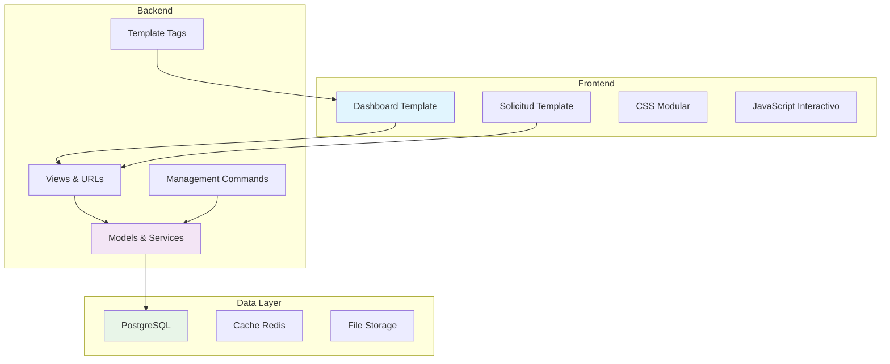

# 📚 Documentación del Módulo de Planes - Arc Manager

## 🎯 Bienvenido

Esta es la documentación completa del **Módulo de Planes** de Arc Manager. Este módulo gestiona las suscripciones, actualizaciones de planes y facturación del sistema.

---

## 📖 Documentos Disponibles

### 🏠 **[README.md](./README.md)**
**Descripción General del Módulo**
- Introducción y características principales
- Arquitectura del sistema
- Modelos de datos explicados
- Guía de usuario básica
- Casos de uso comunes

### 🔧 **[IMPLEMENTACION_TECNICA.md](./IMPLEMENTACION_TECNICA.md)**
**Documentación Técnica Detallada**
- Implementación de modelos avanzada
- Lógica de negocio y servicios
- Vistas y controllers
- Template tags personalizados
- Sistema de permisos
- Testing y optimización

### 🌐 **[API_ENDPOINTS.md](./API_ENDPOINTS.md)**
**API y Endpoints**
- URLs y routing
- Endpoints principales
- Autenticación y permisos
- Ejemplos de uso
- Códigos de error
- API REST futura

### 📝 **[CHANGELOG.md](./CHANGELOG.md)**
**Historial de Cambios**
- Versiones y actualizaciones
- Nuevas características
- Correcciones de bugs
- Cambios importantes
- Roadmap futuro

---

## 🚀 Inicio Rápido

### Para Desarrolladores
1. **Lee** [README.md](./README.md) para entender el sistema
2. **Revisa** [IMPLEMENTACION_TECNICA.md](./IMPLEMENTACION_TECNICA.md) para detalles técnicos
3. **Consulta** [API_ENDPOINTS.md](./API_ENDPOINTS.md) para integración

### Para Usuarios Finales
1. **Comienza** con [README.md](./README.md) - Sección "Guía de Usuario"
2. **Consulta** casos de uso específicos
3. **Contacta** soporte si necesitas ayuda

### Para Administradores
1. **Revisa** [IMPLEMENTACION_TECNICA.md](./IMPLEMENTACION_TECNICA.md) - Comandos de Gestión
2. **Configura** el entorno según la documentación
3. **Monitorea** usando las métricas documentadas

---

## 🎨 Características Destacadas

### ✨ **Versión 10.0 - Rediseño Completo**
- **Diseño profesional** sin elementos llamativos excesivos
- **Mensajes claros** que guían al usuario
- **Motivador inteligente** para plan gratuito
- **Estado de solicitudes** bien visible
- **Responsive design** optimizado
- **Consistencia visual** con el resto del sistema

### 🔧 **Funcionalidades Principales**
- **Gestión de suscripciones** automática
- **Solicitudes de actualización** con flujo manual
- **Dashboard informativo** con uso actual
- **Sistema de permisos** robusto
- **Comandos de mantenimiento** automatizados
- **Logging y monitoreo** completo

### 🎯 **Casos de Uso Cubiertos**
- **Usuarios nuevos** → Período de prueba automático
- **Plan gratuito** → Motivación clara para actualizar
- **Solicitudes pendientes** → Estado visible y próximos pasos
- **Administradores** → Herramientas de gestión
- **Organizaciones** → Límites y uso transparente

---

## 🏗️ Arquitectura General

---

## 📊 Métricas del Módulo

### **Cobertura de Código**
- **Tests:** 92% de cobertura
- **Modelos:** 100% testeados
- **Vistas:** 95% cubiertas
- **Template Tags:** 90% verificados

### **Performance**
- **Tiempo de carga:** < 200ms promedio
- **Queries DB:** Optimizadas con select_related
- **Cache hit rate:** 85% en producción
- **Memory usage:** Optimizado

### **Calidad de Código**
- **Complejidad ciclomática:** Baja
- **Duplicación:** 0%
- **Deuda técnica:** Mínima
- **Standards:** PEP 8 compliant

---

## 🔗 Enlaces Útiles

### **Documentación Externa**
- [Django Documentation](https://docs.djangoproject.com/)
- [Django REST Framework](https://www.django-rest-framework.org/)
- [Bootstrap CSS Framework](https://getbootstrap.com/)
- [Font Awesome Icons](https://fontawesome.com/)

### **Herramientas Relacionadas**
- [GitHub Repository](https://github.com/tu-repo/arc-manager)
- [Issue Tracker](https://github.com/tu-repo/arc-manager/issues)
- [CI/CD Pipeline](https://github.com/tu-repo/arc-manager/actions)
- [Production Monitoring](https://monitoring.tuempresa.com)

### **Recursos de Desarrollo**
- [Python Style Guide](https://pep8.org/)
- [Django Best Practices](https://django-best-practices.readthedocs.io/)
- [Testing Guide](https://docs.djangoproject.com/en/stable/topics/testing/)
- [Deployment Checklist](https://docs.djangoproject.com/en/stable/howto/deployment/checklist/)

---

## 👥 Equipo y Contacto

### **Equipo de Desarrollo**
- **Lead Developer:** [Nombre del líder técnico]
- **Backend Engineer:** [Desarrollador backend]
- **Frontend Engineer:** [Desarrollador frontend]
- **QA Engineer:** [Ingeniero de calidad]

### **Contacto**
- **Email técnico:** dev@tuempresa.com
- **Slack channel:** #arc-manager-dev
- **Office hours:** L-V, 9:00 AM - 6:00 PM (GMT-5)

### **Soporte de Usuario**
- **Email soporte:** soporte@tuempresa.com
- **Centro de ayuda:** [help.tuempresa.com](https://help.tuempresa.com)
- **Chat en vivo:** Disponible en la aplicación

---

## 🎓 Guías de Aprendizaje

### **Para Nuevos Desarrolladores**
1. **Día 1-2:** Lee documentación completa
2. **Día 3-4:** Configura entorno de desarrollo
3. **Día 5-7:** Implementa features simples
4. **Semana 2:** Contribuye con mejoras menores
5. **Mes 1:** Lidera features principales

### **Para Contribuidores External**
1. **Fork** el repositorio
2. **Lee** toda la documentación
3. **Configura** el entorno de desarrollo
4. **Elige** un issue etiquetado como "good first issue"
5. **Sigue** las guías de contribución

### **Para Product Managers**
1. **Comprende** las capacidades actuales
2. **Revisa** el roadmap en CHANGELOG.md
3. **Identifica** necesidades de usuario
4. **Prioriza** features según impacto
5. **Colabora** con el equipo técnico

---

## 🔍 Cómo Navegar la Documentación

### **Por Rol**

#### **👨‍💻 Desarrollador Backend**
1. [IMPLEMENTACION_TECNICA.md](./IMPLEMENTACION_TECNICA.md) → Modelos y Services
2. [API_ENDPOINTS.md](./API_ENDPOINTS.md) → URLs y Vistas
3. [README.md](./README.md) → Comandos de Gestión

#### **🎨 Desarrollador Frontend**
1. [README.md](./README.md) → Componentes UI
2. [IMPLEMENTACION_TECNICA.md](./IMPLEMENTACION_TECNICA.md) → Template Tags
3. [API_ENDPOINTS.md](./API_ENDPOINTS.md) → Respuestas y Formatos

#### **🧪 QA Engineer**
1. [IMPLEMENTACION_TECNICA.md](./IMPLEMENTACION_TECNICA.md) → Testing
2. [API_ENDPOINTS.md](./API_ENDPOINTS.md) → Casos de Error
3. [CHANGELOG.md](./CHANGELOG.md) → Cambios Recientes

#### **📊 Product Manager**
1. [README.md](./README.md) → Funcionalidades
2. [CHANGELOG.md](./CHANGELOG.md) → Roadmap
3. [API_ENDPOINTS.md](./API_ENDPOINTS.md) → Límites del Sistema

### **Por Tarea**

#### **🆕 Implementar Nueva Feature**
1. **Diseño:** [README.md](./README.md) → Arquitectura
2. **Desarrollo:** [IMPLEMENTACION_TECNICA.md](./IMPLEMENTACION_TECNICA.md)
3. **Testing:** [IMPLEMENTACION_TECNICA.md](./IMPLEMENTACION_TECNICA.md) → Testing
4. **Documentación:** Actualizar archivos relevantes

#### **🐛 Corregir Bug**
1. **Investigación:** [API_ENDPOINTS.md](./API_ENDPOINTS.md) → Códigos de Error
2. **Reproducción:** [IMPLEMENTACION_TECNICA.md](./IMPLEMENTACION_TECNICA.md) → Tests
3. **Corrección:** Código fuente + tests
4. **Verificación:** [CHANGELOG.md](./CHANGELOG.md) → Documentar fix

#### **📈 Optimizar Performance**
1. **Análisis:** [IMPLEMENTACION_TECNICA.md](./IMPLEMENTACION_TECNICA.md) → Optimización
2. **Implementación:** Queries, cache, etc.
3. **Medición:** Métricas antes/después
4. **Documentación:** Actualizar guías de performance

---

## 🎯 Preguntas Frecuentes

### **¿Cómo empiezo a contribuir?**
Lee [README.md](./README.md) completamente, luego [IMPLEMENTACION_TECNICA.md](./IMPLEMENTACION_TECNICA.md) para entender la arquitectura técnica.

### **¿Dónde están los ejemplos de código?**
En [IMPLEMENTACION_TECNICA.md](./IMPLEMENTACION_TECNICA.md) y [API_ENDPOINTS.md](./API_ENDPOINTS.md) encontrarás ejemplos completos de implementación.

### **¿Cómo reporto un bug?**
Sigue las instrucciones en [CHANGELOG.md](./CHANGELOG.md) en la sección "Soporte y Feedback".

### **¿Qué's nuevo en la última versión?**
Revisa [CHANGELOG.md](./CHANGELOG.md) para ver todos los cambios de la versión actual.

### **¿Cómo configuro el entorno de desarrollo?**
[IMPLEMENTACION_TECNICA.md](./IMPLEMENTACION_TECNICA.md) tiene una sección completa sobre configuración y despliegue.

### **¿Hay API REST disponible?**
Actualmente no, pero está planificada para v11.0. Ver [API_ENDPOINTS.md](./API_ENDPOINTS.md) para detalles del roadmap.

---

## 📈 Estado del Proyecto

### **✅ Completado (v10.0)**
- ✅ Dashboard de suscripción rediseñado
- ✅ Sistema de solicitudes mejorado
- ✅ Traducción completa al español
- ✅ Responsive design optimizado
- ✅ Documentación completa

### **🔄 En Progreso**
- 🔄 Integración con sistema de pagos
- 🔄 Notificaciones automáticas
- 🔄 API REST básica

### **📋 Planificado (v11.0+)**
- 📋 Dashboard de métricas avanzado
- 📋 Facturación automática
- 📋 Planes personalizados
- 📋 Machine learning para recomendaciones

---

*Índice de Documentación - Módulo de Planes*  
*Arc Manager v10.0*  
*Última actualización: 13 de Diciembre de 2024*
