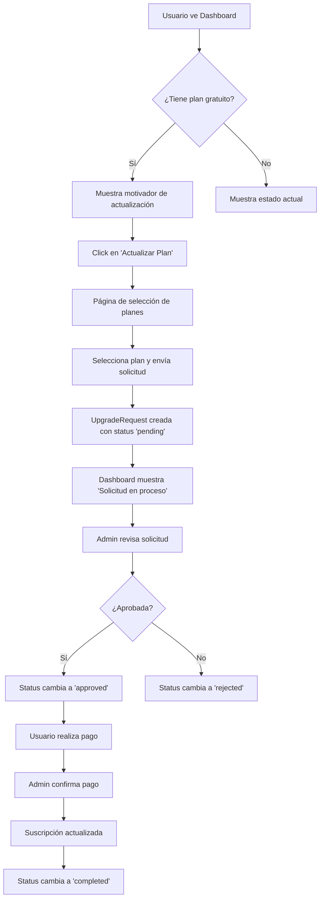

# 📋 Módulo de Planes - Arc Manager

## 📖 Descripción General

El módulo de **Planes** es el sistema de gestión de suscripciones de Arc Manager. Permite a las organizaciones gestionar sus planes de suscripción, solicitar actualizaciones y monitorear el uso de recursos. El sistema está diseñado con un enfoque profesional y mensajes claros para guiar a los usuarios a través del proceso de gestión de suscripciones.

---

## 🏗️ Arquitectura del Módulo

### 📁 Estructura de Archivos

```
arc_manager/apps/plans/
├── __init__.py
├── admin.py                    # Configuración del admin de Django
├── apps.py                     # Configuración de la aplicación
├── models.py                   # Modelos de datos (Plan, Subscription, UpgradeRequest, Payment)
├── views.py                    # Vistas del sistema de planes
├── urls.py                     # Configuración de URLs
├── services.py                 # Lógica de negocio
├── forms.py                    # Formularios (si los hay)
├── templatetags/
│   └── plan_extras.py          # Template tags personalizados
├── management/commands/
│   ├── clean_upgrade_requests.py
│   ├── diagnose_subscriptions.py
│   ├── setup_mvp_plans.py
│   ├── test_upgrade_system.py
│   └── update_expired_subscriptions.py
└── migrations/                 # Migraciones de base de datos

arc_manager/templates/plans/
├── subscription_dashboard.html  # Dashboard principal de suscripción
└── request_upgrade.html        # Solicitud de actualización de plan

arc_manager/static/css/
├── plans.css                   # Estilos del dashboard de suscripción
└── upgrade_plan.css           # Estilos de solicitud de actualización

arc_manager/static/js/
├── plans.js                    # JavaScript del dashboard
└── upgrade_plan.js            # JavaScript de actualización de planes
```

---

## 🗃️ Modelos de Datos

### 1. **Plan**
Modelo que define los planes de suscripción disponibles.

```python
class Plan(models.Model):
    name = models.CharField(max_length=50, choices=PLAN_TYPES, unique=True)
    display_name = models.CharField(max_length=100)
    description = models.TextField(blank=True)
    price = models.DecimalField(max_digits=10, decimal_places=2, default=0)
    max_users = models.PositiveIntegerField(default=1)
    trial_days = models.PositiveIntegerField(default=0)
    billing_cycle_days = models.PositiveIntegerField(default=30)
    grace_period_days = models.PositiveIntegerField(default=0)
    is_active = models.BooleanField(default=True)
```

**Características:**
- ✅ Tipos de plan: `trial` (Prueba Gratuita), `basic` (Plan Básico)
- ✅ Configuración de precios y límites
- ✅ Gestión de períodos de prueba y gracia
- ✅ Estado activo/inactivo

### 2. **Subscription**
Modelo que representa la suscripción de una organización.

```python
class Subscription(models.Model):
    organization = models.OneToOneField('orgs.Organization', on_delete=models.CASCADE)
    plan = models.ForeignKey(Plan, on_delete=models.PROTECT)
    start_date = models.DateTimeField(auto_now_add=True)
    end_date = models.DateTimeField(null=True, blank=True)
    is_active = models.BooleanField(default=True)
    status = models.CharField(max_length=20, choices=STATUS_CHOICES, default='active')
```

**Métodos importantes:**
- `is_trial` - Verifica si es plan de prueba
- `is_expired` - Verifica si está expirado
- `is_in_grace_period` - Verifica período de gracia
- `days_remaining` - Días restantes hasta expiración
- `update_status()` - Actualiza estado automáticamente

### 3. **UpgradeRequest**
Modelo para gestionar solicitudes de actualización de plan.

```python
class UpgradeRequest(models.Model):
    organization = models.ForeignKey('orgs.Organization', on_delete=models.CASCADE)
    current_plan = models.ForeignKey(Plan, on_delete=models.PROTECT, related_name='upgrade_from')
    requested_plan = models.ForeignKey(Plan, on_delete=models.PROTECT, related_name='upgrade_to')
    amount = models.DecimalField(max_digits=10, decimal_places=2)
    status = models.CharField(max_length=20, choices=STATUS_CHOICES, default='pending')
    created_at = models.DateTimeField(auto_now_add=True)
```

**Estados disponibles:**
- `pending` - En proceso
- `approved` - Aprobada
- `rejected` - Rechazada
- `completed` - Completada

### 4. **Payment**
Modelo para registrar pagos y transacciones.

```python
class Payment(models.Model):
    subscription = models.ForeignKey(Subscription, on_delete=models.CASCADE)
    amount = models.DecimalField(max_digits=10, decimal_places=2)
    payment_method = models.CharField(max_length=20, choices=PAYMENT_METHODS)
    payment_type = models.CharField(max_length=20, choices=PAYMENT_TYPES)
    status = models.CharField(max_length=20, choices=STATUS_CHOICES, default='pending')
    description = models.TextField(blank=True)
```

---

## 🎯 Vistas y Funcionalidades

### 1. **SubscriptionDashboardView**
**URL:** `/plans/dashboard/`  
**Template:** `subscription_dashboard.html`  
**Propósito:** Dashboard principal de gestión de suscripción

**Funcionalidades:**
- ✅ Muestra estado actual de la suscripción
- ✅ Motivador para plan gratuito con beneficios claros
- ✅ Indicador de solicitudes pendientes
- ✅ Información de uso actual (usuarios, proyectos)
- ✅ Acciones rápidas en sidebar
- ✅ Lista de planes disponibles para actualización

**Contexto proporcionado:**
```python
{
    'subscription': subscription,
    'organization': organization,
    'is_org_admin': user.is_org_admin,
    'pending_request': pending_request,
    'available_plans': available_plans
}
```

### 2. **RequestUpgradeView**
**URL:** `/plans/solicitar-actualizacion/`  
**Template:** `request_upgrade.html`  
**Propósito:** Solicitud y gestión de actualizaciones de plan

**Funcionalidades:**
- ✅ Comparación visual entre plan actual y planes superiores
- ✅ Formulario de selección de plan
- ✅ Estado de solicitudes pendientes con pasos del proceso
- ✅ Información de beneficios y proceso de actualización
- ✅ Validación de permisos (solo org_admin)

**Estados de vista:**
1. **Solicitud pendiente:** Muestra estado y próximos pasos
2. **Selección de plan:** Grid comparativo de planes disponibles
3. **Sin planes:** Mensaje cuando ya tiene el mejor plan

---

## 🎨 Diseño y UX

### **Principios de Diseño**

1. **🎯 Mensajes Claros vs. Diseños Llamativos**
   - Enfoque en comunicación efectiva
   - Mensajes motivadores profesionales
   - Información estructurada y fácil de entender

2. **📱 Responsive Design**
   - Optimizado para todos los dispositivos
   - Grid adaptativo que se colapsa en móviles
   - Interacciones táctiles amigables

3. **🎨 Consistencia Visual**
   - Utiliza variables CSS del sistema base
   - Mantiene la paleta de colores corporativa
   - Sigue la estructura estándar (`page-container`, `main-content-grid`)

### **Componentes UI Principales**

#### **1. Motivador para Plan Gratuito**
```css
.upgrade-motivator-card {
    background: linear-gradient(135deg, var(--arc-bg-primary) 0%, var(--arc-bg-secondary) 100%);
    border: 2px solid var(--arc-color-primary);
    /* Diseño profesional con mensaje claro */
}
```

**Características:**
- ✅ Icono de cohete para representar crecimiento
- ✅ Lista de beneficios en grid responsive
- ✅ Botón de actualización prominente pero no invasivo
- ✅ Información de precios clara

#### **2. Estado de Solicitud Pendiente**
```css
.request-status-card.pending {
    border-left: 4px solid var(--arc-color-info);
    background: rgba(6, 182, 212, 0.05);
    /* Indicador visual claro del estado */
}
```

**Características:**
- ✅ Icono de reloj indicando proceso en curso
- ✅ Información detallada del plan solicitado
- ✅ Timeline de próximos pasos
- ✅ Datos de contacto para soporte

#### **3. Cards de Información**
```css
.plan-details-card, .usage-card, .features-card {
    background: var(--arc-bg-primary);
    border-radius: var(--arc-border-radius);
    box-shadow: var(--arc-shadow-md);
    /* Diseño consistente con el sistema */
}
```

**Tipos de cards:**
- **Plan actual:** Estado, precio, fechas
- **Uso actual:** Usuarios con progreso, proyectos
- **Características:** Lista de beneficios incluidos
- **Acciones rápidas:** Botones de navegación
- **Planes disponibles:** Comparación y selección

---

## 🔧 Template Tags Personalizados

### **plan_extras.py**

#### **`|format_currency`**
Formatea valores monetarios para mostrar.
```python
@register.filter
def format_currency(value):
    """Formatea un valor decimal como moneda"""
    return f"${value:,.2f}"
```

#### **`|percentage`**
Calcula porcentajes para barras de progreso.
```python
@register.filter
def percentage(value, total):
    """Calcula el porcentaje de uso"""
    if not total or total == 0:
        return 0
    return min(100, round((value / total) * 100))
```

---

## 🚀 Comandos de Gestión

### **1. setup_mvp_plans.py**
```bash
python manage.py setup_mvp_plans
```
**Propósito:** Configura los planes iniciales del MVP
- Crea plan "Prueba Gratuita" (trial)
- Crea plan "Plan Básico" (basic)
- Configura límites y precios

### **2. clean_upgrade_requests.py**
```bash
python manage.py clean_upgrade_requests
```
**Propósito:** Limpia solicitudes de actualización antiguas
- Archiva solicitudes completadas/rechazadas antiguas
- Mantiene la base de datos optimizada

### **3. diagnose_subscriptions.py**
```bash
python manage.py diagnose_subscriptions
```
**Propósito:** Diagnóstica y corrige problemas de suscripciones
- Verifica estados inconsistentes
- Actualiza suscripciones expiradas

### **4. update_expired_subscriptions.py**
```bash
python manage.py update_expired_subscriptions
```
**Propósito:** Actualiza automáticamente suscripciones expiradas
- Cambia estados según fechas
- Aplica períodos de gracia

---

## 🔐 Permisos y Seguridad

### **Restricciones de Acceso**

1. **OrgAdminRequiredMixin**
   - Solo administradores de organización pueden solicitar actualizaciones
   - Protege formularios y vistas sensibles

2. **LoginRequiredMixin**
   - Todas las vistas requieren autenticación
   - Redirección automática al login

3. **Validaciones de Negocio**
   - Solo permite actualizar a planes de mayor valor
   - Previene solicitudes duplicadas
   - Valida estados de suscripción

### **Protección de Datos**
```python
# En models.py - Protección contra eliminación accidental
current_plan = models.ForeignKey(Plan, on_delete=models.PROTECT)
requested_plan = models.ForeignKey(Plan, on_delete=models.PROTECT)
```

---

## 📊 Estados y Flujo de Trabajo

### **Flujo de Actualización de Plan**



### **Estados de Suscripción**

| Estado | Descripción | Acciones Disponibles |
|--------|-------------|---------------------|
| `active` | Suscripción activa y vigente | Solicitar actualización |
| `trial` | Período de prueba gratuita | Actualizar a plan de pago |
| `expired` | Suscripción expirada | Contactar soporte |
| `grace_period` | En período de gracia | Renovar urgentemente |
| `cancelled` | Cancelada por el usuario | Reactivar |

---

## 🎨 Guía de Estilos CSS

### **Variables del Sistema Utilizadas**

```css
/* Colores principales del sistema */
--arc-color-primary: #4285f4;
--arc-color-success: #10b981;
--arc-color-warning: #f59e0b;
--arc-color-danger: #ef4444;
--arc-color-info: #06b6d4;

/* Layout estándar */
--arc-spacing-xs: 0.25rem;
--arc-spacing-sm: 0.5rem;
--arc-spacing-md: 1rem;
--arc-spacing-lg: 1.5rem;
--arc-spacing-xl: 2rem;

/* Elementos visuales */
--arc-border-radius: 12px;
--arc-shadow-md: 0 4px 6px -1px rgba(0, 0, 0, 0.1);
```

### **Clases CSS Principales**

#### **Layout**
- `.page-container` - Contenedor principal estándar
- `.main-content-grid` - Grid de dos columnas (contenido + sidebar)
- `.left-content` - Contenido principal
- `.right-sidebar` - Barra lateral

#### **Componentes**
- `.upgrade-motivator-card` - Tarjeta motivadora para plan gratuito
- `.request-status-card` - Estado de solicitudes pendientes
- `.plan-details-card` - Información del plan actual
- `.usage-card` - Estadísticas de uso
- `.quick-actions-card` - Acciones rápidas

#### **Estados**
- `.status-badge.active` - Plan activo (verde)
- `.status-badge.trial` - Plan de prueba (azul)
- `.status-badge.warning` - Período de gracia (amarillo)
- `.status-badge.expired` - Plan expirado (rojo)

---

## 🧪 Testing y Calidad

### **Casos de Prueba Principales**

1. **Dashboard de Suscripción**
   - ✅ Muestra correctamente el estado del plan
   - ✅ Motivador aparece solo para planes gratuitos
   - ✅ Solicitudes pendientes se muestran correctamente
   - ✅ Uso de recursos se calcula correctamente

2. **Solicitud de Actualización**
   - ✅ Solo permite a org_admin acceder
   - ✅ Previene solicitudes duplicadas
   - ✅ Valida que sea actualización (no downgrade)
   - ✅ Muestra estado correcto de solicitudes pendientes

3. **Responsive Design**
   - ✅ Funciona en móviles (320px+)
   - ✅ Grid se adapta en tablets
   - ✅ Botones son táctiles amigables

### **Comandos de Verificación**

```bash
# Verificar estado de suscripciones
python manage.py diagnose_subscriptions

# Limpiar datos de prueba
python manage.py clean_upgrade_requests

# Actualizar estados expirados
python manage.py update_expired_subscriptions
```

---

## 🚀 Despliegue y Configuración

### **Variables de Entorno**

```env
# En settings.py o .env
PLANS_DEFAULT_TRIAL_DAYS=30
PLANS_DEFAULT_GRACE_PERIOD=7
PLANS_ENABLE_AUTO_RENEWAL=True
```

### **Configuración Inicial**

1. **Ejecutar migraciones:**
```bash
python manage.py migrate plans
```

2. **Crear planes iniciales:**
```bash
python manage.py setup_mvp_plans
```

3. **Verificar configuración:**
```bash
python manage.py diagnose_subscriptions
```

### **Mantenimiento Periódico**

```bash
# Crontab recomendado para producción
# Ejecutar diariamente a las 2 AM
0 2 * * * cd /app && python manage.py update_expired_subscriptions

# Limpiar solicitudes antiguas semanalmente
0 3 * * 0 cd /app && python manage.py clean_upgrade_requests
```

---

## 📈 Métricas y Monitoreo

### **KPIs Importantes**

1. **Conversión de Prueba a Pago**
   - Usuarios que actualizan antes de que expire la prueba
   - Tiempo promedio entre inicio de prueba y actualización

2. **Solicitudes de Actualización**
   - Tasa de solicitudes aprobadas vs rechazadas
   - Tiempo promedio de procesamiento

3. **Uso de Recursos**
   - Porcentaje de usuarios que alcanzan límites
   - Proyectos promedio por organización

### **Logs Importantes**

```python
# En services.py y models.py
logger.info(f"Actualización a {plan.display_name} completada para {org.name}")
logger.warning(f"Solicitud de actualización rechazada: {reason}")
logger.error(f"Error al procesar pago: {error_details}")
```

---

## 🔄 Roadmap y Mejoras Futuras

### **Versión Actual (MVP)**
- ✅ Gestión básica de planes (trial + basic)
- ✅ Solicitudes manuales de actualización
- ✅ Dashboard informativo
- ✅ Comandos de administración

### **Próximas Versiones**

#### **v2.0 - Automatización**
- 🔄 Integración con procesadores de pago (Stripe, PayPal)
- 🔄 Renovación automática de suscripciones
- 🔄 Notificaciones por email de vencimiento
- 🔄 API REST para gestión programática

#### **v3.0 - Análisis**
- 📊 Dashboard de métricas avanzado
- 📈 Reportes de uso y facturación
- 🎯 Recomendaciones inteligentes de plan
- 💰 Gestión de descuentos y promociones

#### **v4.0 - Escalabilidad**
- 🏢 Planes empresariales personalizados
- 🌍 Soporte multi-moneda
- 🔐 Facturación por uso (pay-as-you-go)
- 🤖 Automatización completa del ciclo de vida

---

## 📞 Soporte y Contacto

### **Para Desarrolladores**
- 📧 **Email técnico:** dev@tuempresa.com
- 📖 **Wiki interno:** `/docs/plans/`
- 🐛 **Issues:** GitHub Issues del proyecto

### **Para Usuarios**
- 📧 **Soporte general:** soporte@tuempresa.com
- 📞 **Teléfono:** +1-800-SUPPORT
- 🕒 **Horarios:** L-V, 9:00 AM - 6:00 PM

---

## 📝 Changelog

### **v10.0 (Actual) - Diciembre 2024**
- ✅ Rediseño completo del dashboard de suscripción
- ✅ Implementación de motivador profesional para plan gratuito
- ✅ Indicadores claros de solicitudes en proceso
- ✅ Traducción completa al español
- ✅ Mejoras en responsive design
- ✅ Documentación técnica completa

### **v9.0 - Noviembre 2024**
- ✅ Sistema básico de planes y suscripciones
- ✅ Gestión de solicitudes de actualización
- ✅ Comandos de administración
- ✅ Interface de administración Django

---

*Documentación del Módulo de Planes - Arc Manager v10.0*  
*Última actualización: Diciembre 2024*
