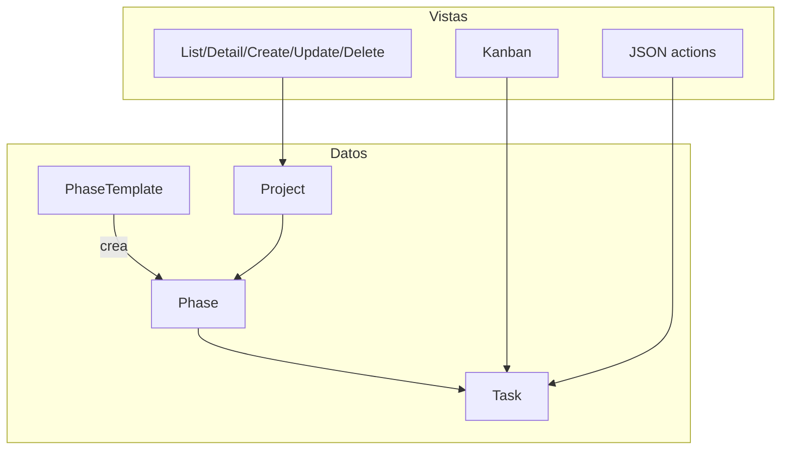

# 🔧 Implementación Técnica — Módulo Projects

## 📋 Tabla de Contenidos
1. Arquitectura del Sistema
2. Modelos de Datos detallados
3. Servicios y creación de fases
4. Vistas y Controllers (incluye Kanban)
5. Formularios y Formsets
6. Template Tags / Helpers
7. Seguridad y Permisos
8. Endpoints y URLs
9. Frontend (kanban.js) e interacciones
10. Testing sugerido
11. Optimización y Performance
12. Configuración y Migraciones
13. Troubleshooting / Observabilidad
14. Roadmap

---

## 🏗️ Arquitectura del Sistema

- Entidades: `Project`, `Phase`, `Task`, `PhaseTemplate`
- Flujo: creación de proyecto → fases (plantilla/manual/fallback) → tareas → tablero Kanban y métricas

---

## 🗃️ Modelos de Datos detallados

Resumen de campos clave (ver `apps/projects/models.py`):

- Project: `organization(FK)`, `owner(FK, SET_NULL)`, `client(FK, SET_NULL)`, `name`, `status{ACTIVE,ARCHIVED,COMPLETED}`, fechas
- Phase: `project(FK)`, `name`, `status{PENDING,IN_PROGRESS,COMPLETED}`, `order`
- Task: `phase(FK)`, `assigned_to(FK, SET_NULL)`, `title`, `description`, `status{TODO,IN_PROGRESS,PAUSED,DONE}`, `priority{LOW,MEDIUM,HIGH}`, `due_date`
- PhaseTemplate: `name`, `description`, `organization(FK|null)`, `phases(JSON)`

Decisiones de diseño:
- Índices en `Task.status`, `Task.priority`, `Task.due_date` para listados rápidos
- `Project.status` y `Phase.status` indexados para selector/filtrado

---

## 🧩 Servicios y creación de fases

`services.py:create_phases_for_project(project, creation_method, phase_template=None, phase_formset=None)`
- `template`: itera `phase_template.phases` (JSON: `[{'name','order'}...]`) y crea `Phase`
- `manual`: usa `phase_formset` validado para construir `Phase`
- fallback: crea 5 fases por defecto con nombres traducidos y `order` incremental
- uso: en `ProjectCreateView.form_valid` tras guardar el `Project`

---

## 🎮 Vistas y Controllers

- ProjectListView: lista por `organization`; `select_related('client','owner')`
- ProjectDetailView: contexto optimizado con `phases` prefetch y métricas de `Task`
- ProjectCreateView: integra `PhaseFormSet` y `create_phases_for_project`
- ProjectUpdateView/DeleteView: restringidas por `organization`
- PhaseDetailView: detalle de fase con proyecto en contexto

Kanban y métricas:
- `project_kanban(pk)`: agrupa por estado, soporta filtro `phase_id`, calcula `project_progress`, prefetch de usuarios de organización; render `projects/kanban_board.html`
- `project_statistics(pk)`: JSON `{success, total_tasks, completed_tasks, in_progress_tasks, paused_tasks}` para UI en tiempo real

Tareas:
- `task_create(project_pk)`: crea tarea, fallback de fase a primera o crea `Backlog`, valida asignación por organización; devuelve JSON si `Accept: application/json`
- `task_edit(pk)`: GET modal, POST actualiza campos, soporta htmx con JSON minimal para actualizar tarjeta
- `task_delete(pk)`: POST JSON `{success: true}`
- Acciones JSON puras: `update_task_status(task_pk)`, `move_task(task_pk)` soportan `application/json` y form-urlencoded

Plantillas de fase:
- CRUD con `PhaseTemplate{List,Create,Detail,Update,Delete}` y `PhaseTemplateForm`
- Selector Kanban: `ProjectKanbanSelectorView` con agrupación por `Project.status`

---

## 🧾 Formularios y Formsets

- `ProjectForm`: elige método de creación de fases (template/manual). Filtra `Client` y `PhaseTemplate` por organización
- `PhaseFormSet`: valida unicidad de nombres; relaja `name` si marcado DELETE
- `TaskForm`: campos básicos; `assigned_to` filtrado por `user.organization`

---

## 🏷️ Template Tags / Helpers

`templatetags/project_extras.py`
- `get_item` y `dict_get` para acceder seguro a dicts (p. ej., contadores por fase)

---

## 🔐 Seguridad y Permisos

- Todas las vistas con `LoginRequired`
- Filtro de `organization` en `get_queryset` y en búsquedas `get_object_or_404`
- Validación de asignación: usuarios activos de la organización, excluye superusers
- JSON POST requiere CSRF; JS envía token

---

## 🌐 Endpoints y URLs

Ver `docs/tecnico/projects/API_ENDPOINTS.md` para tabla completa y ejemplos.

---

## 🖥️ Frontend (kanban.js)

- Drag & drop por columnas (`data-status-code`), POST a `/projects/tasks/<id>/update_status/`
- Actualización silenciosa de tarjeta y contadores, y refresco de estadísticas con `/projects/<id>/statistics/`
- Modales: crear tarea (FormData, JSON/HX), editar/ver tarea (modal y fallback navegación)
- Utilidades: filtros por fase, clear/refresh, notificaciones mínimas

---

## 🧪 Testing sugerido

- Access control por `organization` en todas las vistas
- Creación de proyecto con plantilla y manual (formset válido/DELETE, unicidad)
- Kanban: cálculo de métricas, `tasks_by_status`, filtro `phase_id`
- JSON: `update_task_status`, `move_task`, `task_delete`, creación con asignado inválido

---

## ⚡ Optimización y Performance

- `select_related` y `prefetch_related` en vistas de detalle/kanban
- Cálculo de contadores por fase usando datos prefetchados para evitar N+1
- Endpoints JSON ligeros y específicos para UI reactiva

---

## ⚙️ Configuración y Migraciones

- Sin settings específicos del módulo
- Asegurar migraciones aplicadas para `projects`

---

## 🛠️ Troubleshooting / Observabilidad

- Si drag & drop no actualiza, verificar CSRF y rutas `/projects/tasks/<id>/update_status/`
- Si asignación falla, confirmar que el usuario pertenezca a la organización y no sea superusuario
- Revisar consola del navegador para errores de red y respuesta JSON

---

## 🗺️ Roadmap

- Filtros avanzados (asignado, prioridad, due date)
- Búsqueda en Kanban y acciones masivas
- API REST con DRF y Webhooks

Última actualización: Diciembre 2024
